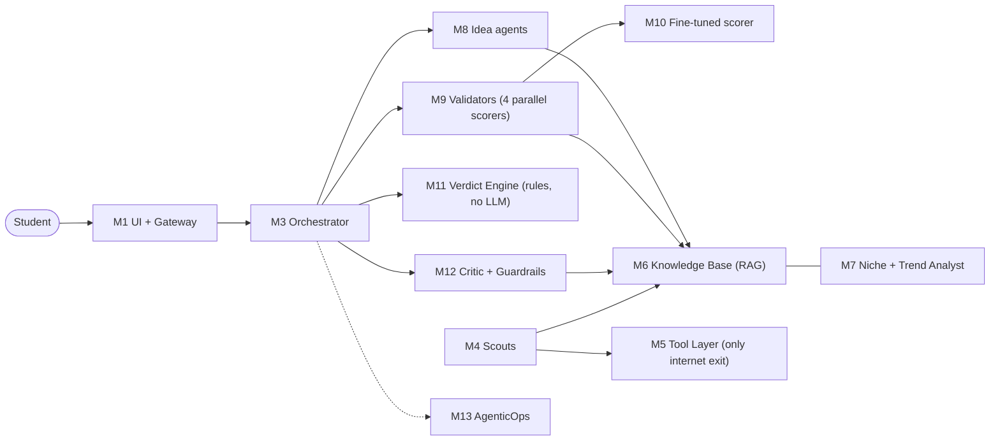

# Idea Generator with Go / No-Go

An interactive **multi-agent system that helps a student choose a project**. It collects startup ideas, products and niches from public sources (YC directory, Hacker News, GitHub), organises them into a map of niches and trends, and works in two modes:

- **Discover** — give your profile (skills, hours, team size, compute, goal) and get ranked ideas that fit you, including new ideas built from gaps found in the data.
- **Validate** — bring an idea and get a verdict **GO / PIVOT / NO-GO / INSUFFICIENT EVIDENCE**, with the evidence behind it, what would change it, and how stable it is.

> The language model **never** decides the verdict. Models produce evidence-backed scores on six dimensions; a deterministic, unit-tested **Verdict Engine** turns them into the verdict.

Semester project for **CS4032 Software Construction and Development** (FAST-NUCES) by **Zain** and **Ahmad**.

**Status:** shared contracts (Z0) and the seven AI-core services are built. The Verdict Engine (Z2, rules in [`config/verdict.yaml`](config/verdict.yaml)), AgentOps (Z3), the scorer (Z4, base model), the validators (Z5), the critic (Z6), ideation and the orchestrator's Discover, Validate, challenge and what-if workflows (Z7, Z8) are real. The Profile service, Knowledge Base, niche analyst, scouts, tool layer and gateway are not built yet, so runs only work against the fakes in the tests (setup in [`docs/setup.md`](docs/setup.md) §7). Progress: [`docs/checklist.md`](docs/checklist.md).

---

## Architecture at a glance



14 modules, one container each, deployed on Kubernetes with GitHub Actions (PR checks) and Jenkins (delivery). Full design: [`docs/architecture/architecture.md`](docs/architecture/architecture.md).

| Layer | Tech |
|-------|------|
| Backend | Python 3.12, FastAPI, Pydantic v2 |
| UI | React + Vite + TypeScript |
| Data | PostgreSQL 16 + pgvector (hybrid search), Redis |
| LLMs | Gemini (hosted, via M5), fine-tuned Qwen2.5-1.5B (QLoRA → GGUF on llama.cpp), Ollama for dev |
| Platform | Docker, Kubernetes (minikube + Calico), Kustomize, GitHub Actions, Jenkins, GHCR |

## Quick start

> Commands become available as phases land; see [`docs/setup.md`](docs/setup.md) for the full, step-by-step setup.

```bash
# 1. Clone and prepare
gh repo clone Zain-Shykh/idea-validator && cd idea-validator
python3.12 -m venv .venv && source .venv/bin/activate
pip install -r requirements-dev.txt
pip install -e libs/common      # shared contracts package
cp .env.example .env            # add GEMINI_API_KEY, GITHUB_TOKEN, passwords

# 2. Local development (Docker Compose)
docker compose up --build       # today: orchestrator :8003, ideation..agentops :8008-8013 (UI :5173 and API :8001 after A1)

# 3. Kubernetes
minikube start -p idea-validator --cni=calico --cpus=6 --memory=7g
minikube -p idea-validator addons enable ingress && minikube -p idea-validator addons enable metrics-server
# scripts/create_secrets.sh     # from .env (after A0)
# until images are on GHCR, build and load them first: docs/setup.md §6
kubectl apply -k k8s/overlays/dev
kubectl get pods -n idea-validator
# open http://$(minikube -p idea-validator ip)/   (after A0/A1: Ingress and UI)
```

Checks: `ruff check . && ruff format --check . && mypy libs services` · `python scripts/check_registry.py` (a changed rubric, prompt, budget or verdict rule needs a new version, then `--update`) · after a contract change `python -m common.contracts.export`, verified by `--check`.

Tests: `pytest -q` (unit + contract) · `pytest -m integration` (needs `docker compose up -d postgres redis`; the AgentOps tests also need `AGENTOPS_TEST_DATABASE_URL`, docs/setup.md §5) · UI: `cd services/ui && npm test`.

## Repository layout

```text
docs/            requirements, architecture (+deviations), ADRs, plans, specs, workflow, setup, report, evidence
libs/common/     shared contracts (Pydantic + JSON Schema), service bootstrap, trace/LLM/HTTP clients
services/        ui, gateway, profile, orchestrator, scouts, tools, kb, analyst,
                 ideation, validators, scorer, verdict, critic, agentops   (one Dockerfile each)
jobs/            ingestion, finetune, evaluation
rubrics/ prompts/ config/     versioned rubrics, prompts, weights/thresholds/budgets
eval/            labelled ideas, retrieval queries, behaviour cassettes, results
k8s/             Kustomize base + overlays          .github/workflows/  PR checks       Jenkinsfile  delivery
data/snapshots/  card data snapshot                 scripts/            helper scripts
```

## Documentation

| Doc | What |
|-----|------|
| [`docs/requirements.md`](docs/requirements.md) | All requirements with IDs (single source of truth) |
| [`docs/architecture/architecture.md`](docs/architecture/architecture.md) | Architecture, diagrams, contracts, deployment |
| [`docs/architecture/deviations.md`](docs/architecture/deviations.md) | Changes from the designed architecture |
| [`docs/decisions/`](docs/decisions/) | Design decision records |
| [`docs/decisions.md`](docs/decisions.md) | Running log of implementation decisions |
| [`docs/work-distribution.md`](docs/work-distribution.md) | Who owns what, parallel tracks, sync points |
| [`docs/implementation-plan-zain.md`](docs/implementation-plan-zain.md) | Zain's phases (Ahmad's: `docs/implementation-plan-ahmad.md`) |
| [`docs/workflow.md`](docs/workflow.md) | Spec-driven workflow, branches, PRs, headless sessions |
| [`docs/specs/`](docs/specs/) | One spec + plan + test report per phase |
| [`docs/checklist.md`](docs/checklist.md) | Requirement progress |
| [`docs/conventions.md`](docs/conventions.md) | Code, test, Docker, K8s conventions |
| [`docs/setup.md`](docs/setup.md) | Machine setup |
| [`docs/ai-usage-log.md`](docs/ai-usage-log.md) | AI-usage log |
| [`docs/report/`](docs/report/), [`docs/evidence/`](docs/evidence/) | Final report, screenshots and measurements |

## Contributing

`main` is protected: branch → spec → plan → code + tests → PR → review by the other member → merge. Conventional commits. Details in [`docs/workflow.md`](docs/workflow.md).

## Data and ethics

Only official APIs or pages that allow it, `robots.txt` and rate limits respected, no private data, every card keeps its source URL. Fetched text is treated as data, never as instructions.
