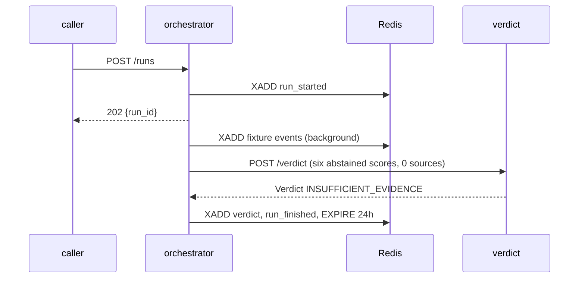

# Z1 — Walking skeleton of Zain's services

| Field | Value |
|-------|-------|
| Phase | `Z1` from `docs/implementation-plan-zain.md` |
| Owner | Zain |
| Author | Claude Code headless session (`scripts/run-phase.sh`) |
| Branch | `feat/z1-walking-skeleton` (from `feat/z0-contracts-common`, PR #3) |
| Status | Draft spec |
| Requirement IDs | GEN-6, GEN-8, DOCK-1..3, K8S-1, K8S-5 (probes), K8S-11, AVOID-8 |
| Architecture refs | `architecture.md` §5, §6.1, §6.7, §7.2, §17, §19, §20, §21; ADR-004 |
| Depends on | Z0 (`libs/common`). A0 does not exist: minimal compose, kustomization and dev overlay are created here |
| Issue / PR | filled at PR time |

---

## Part A — Specification

### A1. Objective
A thin, deployable version of Zain's seven services (`orchestrator`, `ideation`, `validators`, `scorer`, `verdict`, `critic`, `agentops`) running in Compose and on the `idea-validator` minikube profile, each answering with contract-valid stub payloads, so packaging and wiring problems appear now and not in the last week (AVOID-8).

### A2. Context
- Callers: the gateway (A8) calls the orchestrator; the orchestrator calls verdict. All other edges arrive with later phases.
- Exists: `libs/common` (contracts, `create_app`, `ServiceClient`, `TraceClient`).
- Fake: every service's logic. M2, M6, M7, M5 and the gateway do not exist.

### A3. Scope
**In scope**
- Seven services with stub endpoints for every M3/M8/M9/M10/M11/M12/M13 route of §7.2.
- Per service: Dockerfile, `requirements.txt`, `compose.yaml`, `k8s/base/<svc>.yaml`, tests.
- Orchestrator stub run: events on the Redis stream, verdict fetched from the verdict service.
- Minimal `docker-compose.yml`, `k8s/base/{namespace,kustomization}.yaml`, `k8s/overlays/dev` (with a dev-only Redis). Ahmad takes these over in A0.

**Out of scope**
- Rules, scoring, prompts, model calls (Z2–Z8); `ops` database and trace storage (Z3).
- NetworkPolicies, Ingress, Postgres in the cluster, GHCR push, CI, Jenkins (A0, A10).
- Rubric/prompt/config ConfigMaps (Z2, Z3); measured requests/limits (Z11).

### A4. Requirements and acceptance criteria

| # | Req ID | Acceptance criterion | Verified by (test name / command) |
|---|--------|----------------------|-----------------------------------|
| 1 | GEN-8, GEN-6 | Given `docker compose up`, all 7 services plus Postgres and Redis are healthy and every `/health` and `/ready` returns 200 | `docker compose up -d --wait`, then curl ports 8003, 8008–8013 (manual, output in C3) |
| 2 | GEN-8 | Each app serves `/health`, `/ready`, `/metrics`; the orchestrator's `/ready` is 503 when Redis is down or `VERDICT_URL` is unset | `services/*/tests/unit/test_api.py::test_health_ready_metrics`, `services/orchestrator/tests/unit/test_api.py::test_ready_fails_without_redis` |
| 3 | DOCK-1..3, K8S-11 | 7 images build from the repo root, multi-stage, base pinned by digest, `id -u` ≠ 0, tagged with the short git SHA | `docker build …`, `docker run --rm  id -u` (manual, C3); `eval/behaviour/test_packaging.py::test_dockerfile_is_pinned_multistage_nonroot` |
| 4 | K8S-1, K8S-5 | `kubectl apply -k k8s/overlays/dev` gives all 7 deployments Ready on the `idea-validator` profile | `kubectl --context idea-validator -n idea-validator get pods` (manual, C3) |
| 5 | K8S-5, K8S-11 | Every workload has liveness `/health`, readiness `/ready`, requests and limits, non-root securityContext, a non-`latest` image | `eval/behaviour/test_packaging.py::test_manifest_workload_standards` |
| 6 | GEN-7 | Every stub request and response validates against `common.contracts`; invalid input gives the 422 error envelope | `services/*/tests/unit/test_api.py` |
| 7 | AVOID-8, U3, §6.7 | A stub run appends the fixture's event sequence to `run:{run_id}:events`, in order, each a valid `RunEvent`, the `verdict` event holding a valid `Verdict` returned by the verdict service | `services/orchestrator/tests/unit/test_run.py::test_run_emits_fixture_sequence`, `services/orchestrator/tests/integration/test_redis_stream.py`, compose and cluster smoke (C3) |
| 8 | AVOID-3, AVOID-4 | No stub invents a score, claim or verdict: scores abstain, claims are `unverifiable`, the stub verdict is always `INSUFFICIENT_EVIDENCE` with `missing` | `services/verdict/tests/unit/test_api.py::test_stub_verdict_is_insufficient_evidence`, `…validators…::test_scorers_abstain`, `…critic…::test_check_marks_every_claim_unverifiable` |
| 9 | K8S-1 | kubeconform accepts the rendered manifests | `kubectl kustomize k8s/overlays/dev \| kubeconform -strict -summary` |

### A5. Interfaces and contracts
No contract file changes. All services listen on 8000 and use `common.service.create_app`.

| Service | Stub endpoints → response | Stub behaviour |
|---------|---------------------------|----------------|
| orchestrator | `POST /runs` → 202 `StartRunResponse` | writes the run's events, calls verdict |
| | `POST /runs/{id}/{answer,approve,resume}` → 202, empty | 404 for an unknown run |
| | `POST /ideas/{id}/challenge` → `ChallengeResponse` | outcome `removed`, verdict from verdict service |
| | `POST /ideas/{id}/whatif` → `WhatIfProposalsResponse`, or 202 `WhatIfApplyResponse` with `apply` | no proposals; apply starts a stub run |
| verdict | `POST /verdict` → `Verdict`; `POST /whatif` → `WhatIfResponse`; `GET /config` → `VerdictConfigResponse` | always `INSUFFICIENT_EVIDENCE` |
| ideation | `POST /intake`, `/ideate`, `/gap-analyze`, `/skeptic`, `/concretize` | no questions, ideas only from supplied gap evidence, no objections |
| validators | `POST /score/{demand,competition,feasibility,risk}` → `ScorerResponse` | abstain; unknown scorer 404 |
| scorer | `POST /score` → `DimensionScore` | abstain; unknown rubric dimension 422 |
| critic | `POST /check`, `/rail/input`, `/scan`, `/policy/approval` | claims `unverifiable`; input allowed with a stub reason; nothing flagged; approval always required |
| agentops | `POST /trace` → 202; `GET /runs/{id}/trace`, `/summary`, `/registry`, `/drift/latest`, `/eval/latest` | trace batches accepted and discarded; empty trace, zero summary, empty reports |

- **Run event stream (interface for A8):** key `run:{run_id}:events`, one `XADD` per event with a single field `event` holding the `RunEvent` JSON; `MAXLEN ~ 5000`; expiry 24 h set after the last event.
- Trace: the orchestrator emits one `decision` record around the verdict call.
- Env vars: `VERDICT_URL`, `AGENTOPS_URL`, `REDIS_HOST`, `REDIS_PORT`, `REDIS_PASSWORD`, `LOG_LEVEL` (all already in `.env.example`); compose-only `IMAGE_TAG`, `POSTGRES_HOST_PORT`, `REDIS_HOST_PORT`.

### A6. Design
```text
services/<svc>/
  Dockerfile  requirements.txt  compose.yaml
  src/<pkg>/{__init__,main}.py  api/routes.py        # stubs are small enough to live in the routes
  tests/unit/test_api.py
services/orchestrator/src/orchestrator/{settings.py, services/stub_run.py,
  repositories/events.py, fixtures/run_events_validate.jsonl}
```

The orchestrator image excludes `eval/`, so it carries a copy of the event fixture; a test keeps the copy byte-identical to `eval/fixtures/run_events_validate.jsonl`.

### A7. Edge cases and failure handling
| Case | Expected behaviour |
|------|--------------------|
| Redis down on `POST /runs` | 503 envelope `DEPENDENCY_UNAVAILABLE`, no run id |
| Redis down on `/ready` | 503 `NOT_READY`; `/health` stays 200 |
| Verdict service down, slow or replying with an invalid body | stream gets `error` then `run_finished` (message says failed); no `verdict` event; challenge returns 503 |
| Redis fails mid-run | logged; the background task never crashes the service |
| Invalid request body | 422 envelope without echoing values |
| `VERDICT_URL` unset | orchestrator `/ready` 503; `/health` 200 |
| AgentOps down | run unaffected (`TraceClient` buffers) |
| Unknown run id / unknown scorer | 404 envelope |

### A8. Test plan
| Level | What | Command |
|-------|------|---------|
| Unit + contract | each endpoint via `TestClient`; orchestrator with an in-memory Redis double and a fake verdict transport | `pytest services -q` |
| Packaging | Dockerfiles, compose fragments, manifests, fixture copy | `pytest eval/behaviour/test_packaging.py -q` |
| Integration | real Redis stream | `pytest -m integration services/orchestrator -q` |
| Compose / cluster smoke | health, ready, one run, events read from the stream | commands in C3 |
Coverage target: ≥ 80 % of `services/*/src`.

### A9. Assumptions and open questions
- The stub verdict is always `INSUFFICIENT_EVIDENCE`. A canned GO would be a decision nothing computed; Ahmad's UI already has a GO example in the SSE fixture.
- The stub run plays the Validate sequence for both workflows and for what-if apply. Its progress messages are the fixture's made-up text (for example "4 evidence items"); only the verdict is really produced by a call.
- The orchestrator keeps no run state beyond the stream; "unknown run" means no stream.
- `POST /runs` answers 202 (§7.2 gives no status for it).
- The profile in `/ideas/{id}/challenge` and `/whatif` is not in the request (M2 does not exist), so the stubs use a placeholder profile.
- Compose ports bind to `127.0.0.1` only.

### A10. Risks
| Risk | Mitigation |
|------|------------|
| Disk (~7.8 GB free) | identical build steps so six images share the dependency layer; remove built images at the end |
| A0 later conflicts with the temporary files | they are minimal and listed in the PR for Ahmad to take over |
| Host port 5432 already taken | host ports configurable |

---

## Part B — Plan

*(added next)*
