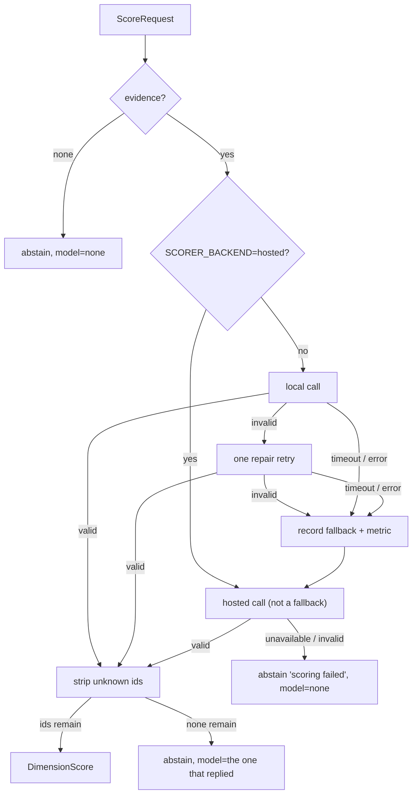

# Z4 — M10 Scorer serving (base model + fallback)

| Field | Value |
|-------|-------|
| Phase | `Z4` from `docs/implementation-plan-zain.md` |
| Owner | Zain |
| Author | Claude Code headless session (`scripts/run-phase.sh`) |
| Branch | `feat/z4-scorer-serving` (parent: `feat/z3-rubrics-agentops`, PR #9) |
| Status | In review (A4 #4 open: disk) |
| Requirement IDs | M10-1 (container), M10-2, M10-3, M10-5, FT-7, API-I3, AO-1, AO-6 (fallback metric) |
| Architecture refs | `architecture.md` §7.2, §12.1, §12.2, §14.2, §17, §21.4; ADR-005, ADR-003; D-002, D-007 |
| Depends on | Z3 (rubrics, prompts, trace, ops events). M5 not built: `LLM_BACKEND=direct` or cassettes |
| Issue / PR | — / — |

---

## Part A — Specification

### A1. Objective
Serve rubric-based scoring behind `POST /score`: a local 1.5B model (the **base** Qwen2.5-1.5B-Instruct until Z9) applies one rubric to one idea and its evidence. Every reply is validated; an invalid one is retried once; then a hosted model is used and the fallback is logged. Without usable evidence the scorer abstains.

### A2. Context
- Caller: M9 validators (Z5), one call per dimension. Callees: llama.cpp sidecar (k8s) or host Ollama (dev); `common.llm` alias `scorer-hosted` (fallback); M13 (`/trace`).
- Exists: `ScoreRequest`, `DimensionScore`, `ScorerOutput`, `Rubric` contracts; `common.registry` (rubrics, prompts); `prompts/scorer@v1.md`; `common.llm`, `common.trace`; `ScorerFallbackEvent`. `services/scorer` is a stub that always abstains.
- Still fake: M5 (`/llm/chat`). No Gemini key is available in this phase, so the hosted path is tested with cassettes only.

### A3. Scope
**In scope:** `services/scorer` (prompt builder, local OpenAI-compatible backend, validation, retry, fallback, abstention, readiness probe, traces, metric); `jobs/finetune/model-image/`; `k8s/base/scorer.yaml` (wrapper + llama.cpp sidecar, `models` PVC, `model-import` Job); compose fragment; a check script for 10 fixture pairs; latency and memory measurements.

**Out of scope:** feature computation and retrieval (Z5); claim checking and injection scanning (Z6); per-run budgets (Z7, M5); training, fine-tuned weights and the base / fine-tuned / hosted comparison (Z9, M10-4); publishing images to GHCR and NetworkPolicies (Ahmad, A0/A10); final resource limits (Z11).

### A4. Requirements and acceptance criteria

Tests live in `services/scorer/tests/unit/` unless a path is given.

| # | Req ID | Acceptance criterion | Verified by |
|---|--------|----------------------|-------------|
| 1 | M10-1, M10-2, API-I3 | With the base model, `/score` returns a schema-valid `DimensionScore` for 10 fixture (idea, evidence) pairs across all six rubrics | live: `python scripts/scorer_check.py` against `SCORER_BACKEND=ollama`; offline replay of the recorded replies: `eval/behaviour/test_scorer_cassettes.py::test_recorded_base_model_replies_give_valid_scores` |
| 2a | M10-3, AO-7 | Given a local reply that is invalid, when `/score` runs, exactly one repair retry follows; if it is still invalid the hosted alias `scorer-hosted` is called and the response says `model=scorer-hosted` | `eval/behaviour/test_scorer_cassettes.py::test_invalid_json_retries_once_then_falls_back` |
| 2b | M10-3, AO-7 | Given the local backend times out (or is unreachable), the hosted fallback is called without a retry | `…::test_local_timeout_falls_back` |
| 2c | M10-3, AO-1, AO-6 | A fallback emits a `scorer_fallback` ops event trace with `model=scorer-hosted` and increments `ideaval_scorer_fallbacks_total{dimension}` | `…::test_invalid_json_retries_once_then_falls_back` |
| 3 | M9-4, AVOID-4 | Ids not in the provided evidence are stripped (from the list and from the reason); if none remain the response is an abstention (score null, confidence 0) | `test_scoring.py::test_unknown_ids_are_stripped`, `::test_only_unknown_ids_abstains` |
| 4 | FT-7, K8S-1 | On minikube the Job copies the model from the `scorer-model` image into the PVC, the sidecar loads it and `/ready` turns 200 only after the model answers a probe prompt | manifest test `eval/behaviour/test_packaging.py::test_scorer_pod_serves_the_model_from_the_pvc`; probe: `test_api.py::test_ready_only_after_probe`; cluster check (only if the disk budget allows, see A10) |
| 5 | M10-5 | p50 latency per score and pod memory are measured and written into C4; no weights in git | `scripts/scorer_check.py` output; `kubectl top` / `ollama ps`; `git ls-files '*.gguf'` empty |

### A5. Interfaces and contracts
- `POST /score` — `ScoreRequest` → `DimensionScore` (200). 422 `VALIDATION_ERROR` for a bad body or an unknown rubric id/version. 503 `NOT_READY` when rubrics or the prompt cannot be loaded. Model failures are **not** HTTP errors: they end in an abstention.
- `DimensionScore.model`: `SCORER_MODEL_ID` (`scorer-base@v1`) for a local score, `scorer-hosted` for a hosted one, `none` when no model produced a usable reply or none was called.
- `/ready` — 200 only after rubrics and prompt load and (backends `llamacpp`, `ollama`) one probe completion succeeded.
- Traces (agent `scorer`): one `llm_call` per model call (retry number, tokens, prompt version `scorer@v1`; local cost 0); one `decision` record `tool="scorer_fallback"`, `model="scorer-hosted"`, `output=ScorerFallbackEvent` per fallback. `run_id` from `X-Run-Id`; without it `run_adhoc_<hex>`.
- Metric: `ideaval_scorer_fallbacks_total{dimension}`; the definition moves to `common.metrics` so M10 and M13 share it.
- `common.llm`: `strip_fence` becomes public (additive).
- Env (prefix `SCORER_`): `SCORER_BACKEND=llamacpp|ollama|hosted` (default `llamacpp`), `SCORER_MODEL_URL` (llama.cpp base URL), `OLLAMA_BASE_URL`, `SCORER_LOCAL_MODEL` (`qwen2.5:1.5b`), `SCORER_MODEL_ID`, `SCORER_LOCAL_TIMEOUT_S`, `SCORER_HOSTED_TIMEOUT_S`, `SCORER_RUBRICS_DIR`, `SCORER_PROMPTS_DIR`. `SCORER_URL` stays the address *of* the scorer, so the model's address has another name.

### A6. Design

Modules under `services/scorer/src/scorer/`:
- `services/prompt.py` — pure: renders `scorer@v1` into a system message (instructions + rubric scale and anchors) and a user message (idea, features, evidence blocks, output rules). Z9 reuses it to build training data.
- `services/backend.py` — `LocalModel`: `POST {url}/v1/chat/completions` (llama.cpp and Ollama) with a JSON-schema `response_format`, temperature 0.
- `services/scoring.py` — `Scorer`: the flow below.
- `settings.py`, `api/routes.py`, `main.py` (lifespan: readiness probe task, trace flush).

- **Valid reply** = `ScorerOutput` shape with no extra keys, `score` a multiple of 0.5 in 0–5, `confidence` 0–1, non-empty `reason`, `evidence_ids` a list of strings. The id check comes after (strip, then abstain if empty), so an unknown or missing id is never retried into a different made-up one.
- **Deadlines:** one for all local work (both attempts) and one for the hosted fallback; their sum stays below the caller's 90 s (§21.4).
- **Prompt bounds** (model context 4096, applied to the escaped text): at most 12 evidence items, 500 characters per quote within a shared 4800, 3000 for the idea, 1000 for features (Z4-13); only ids that are in the prompt count as provided.
- **Prompt safety:** idea, quotes, source and features are XML-escaped, and the template is filled in one pass, so input cannot close a block or inject a placeholder.
- **Pod:** `scorer` wrapper + `llama-server` sidecar (pinned `ghcr.io/ggml-org/llama.cpp:server-v1.1.0@sha256:…`) bound to the pod's loopback, GGUF on PVC `models`; an init container waits for the file. `model-import-base-v1` Job runs the `scorer-model:base-v1` image and copies the GGUF (checksum verified, atomic rename, no-op if already there).

### A7. Edge cases and failure handling
| Case | Expected behaviour |
|------|--------------------|
| No evidence | abstain, no model call |
| Local timeout / connection error / HTTP error / unexpected response shape | hosted fallback, no retry |
| Invalid JSON, wrong fields, score 3.3 or 6, markdown fence | fence is stripped; otherwise one repair retry, then fallback |
| Unknown evidence ids | stripped; none left → abstain |
| Reason cites an unknown id | replaced by `[unknown id]` |
| Hosted unavailable, invalid twice, or not configured | abstain, reason starts `scoring failed`, `model=none` |
| Unknown rubric dimension or version | 422 |
| More evidence than the prompt bound | first 12 used; ids of the rest are not accepted |
| Idea or quote contains `</evidence>` or `{{evidence}}` | escaped / left literal |
| Model not loaded yet | `/ready` 503 until the probe succeeds |

### A8. Test plan
| Level | What | Command |
|-------|------|---------|
| Unit | prompt builder, backend (mock transport), scoring flow, API, readiness | `pytest services/scorer -q --cov=scorer` |
| Behaviour (cassettes) | AO-7 invalid JSON and timeout; recorded base-model replies for the 10 pairs | `pytest eval/behaviour -q` |
| Packaging | Dockerfile, compose, manifests, Job | `pytest eval/behaviour/test_packaging.py` |
| Live | 10 pairs against host Ollama `qwen2.5:1.5b` | `python scripts/scorer_check.py --url …` |
| Image / manifests | build the scorer image; `kubectl kustomize` + kubeconform | see C3 |
| Cluster | what fits the disk budget | see C3 |

Coverage target: ≥ 80 % of `scorer` business logic.

### A9. Assumptions and open questions
- Abstention (not 503) is the answer when both models fail: §12.2 says a scorer abstains. `model=none` lets M3 (Z7) avoid caching such a result.
- A reply with valid shape but no usable id is an abstention at once (A4 #3), not a format error.
- The worked examples of a rubric are not put in the prompt: they cost CPU time and a 1.5B model can copy their ids.
- Ollama's `qwen2.5:1.5b` is the base model in GGUF Q4_K_M, so its blob can fill the model image locally; the official `Qwen/Qwen2.5-1.5B-Instruct-GGUF` file is the documented alternative.
- No Gemini key: the live hosted call stays **not verified**.

### A10. Risks
| Risk | Mitigation |
|------|-----------|
| Disk (4.6 GB free, floor 2 GB). Importing the real 986 MB model through the Job needs the image content, its unpacked snapshot and the PVC copy (≈ 3 GB) plus the llama.cpp image (≈ 1.13 GB) = ≈ 4.3 GB in the node | Do not run the real import. Check the pieces that fit: sidecar with the real GGUF mounted without a copy, Job with a tiny stand-in file. A4 #4 stays unticked unless the whole path ran |
| CPU latency: 4–6 parallel scores queue on one model | measure; deadlines in env vars; report for Z5 |
| A 1.5B base model often ignores the format | JSON-schema-constrained output, one retry, fallback |

---

## Part B — Plan

### B1. Task breakdown

| # | Task | Files | Verification | Done |
|---|------|-------|--------------|------|
| 1 | Shared fallback counter; public `strip_fence` | `libs/common/src/common/{metrics,llm}.py`, `services/agentops/src/agentops/services/metrics.py` | `pytest libs services/agentops` | [x] |
| 2 | Settings and pure prompt builder with bounds and escaping | `services/scorer/src/scorer/{settings.py,services/prompt.py}` | `test_prompt.py` | [x] |
| 3 | Local backend and scoring flow (validate, retry, fallback, strip, abstain, traces) | `scorer/services/{backend,scoring}.py` | `test_scoring.py`, `test_backend.py` | [x] |
| 4 | Routes, readiness probe, lifespan; replace stub tests | `scorer/{main.py,api/routes.py}` | `test_api.py`; `pytest eval/behaviour` | [x] |
| 5 | 10 fixture pairs, check script, live run on `qwen2.5:1.5b`, record cassettes, latency | `eval/fixtures/score_requests.jsonl`, `scripts/scorer_check.py`, `eval/behaviour/{cassettes/,test_scorer_cassettes.py}` | live report; cassette tests offline | [x] |
| 6 | Image, compose fragment, env names | `services/scorer/{Dockerfile,requirements.txt,compose.yaml}`, `.env.example` | docker build; container `/score` | [x] |
| 7 | Model image and manifests | `jobs/finetune/model-image/{Dockerfile,README.md}`, `k8s/base/scorer.yaml`, `eval/behaviour/test_packaging.py` | kubeconform; packaging tests | [x] |
| 8 | Cluster check within the disk budget | — | recorded in C3 | [x] |
| 9 | Testing subagent, fixes, docs, PR | — | full suite green | [x] |

### B2. Commit plan
1. `docs(spec): add Z4 spec` · 2. `docs(plan): add Z4 plan`
3. `refactor(common): share the fallback counter and strip_fence`
4. `feat(scorer): validate, retry, fall back and abstain behind /score`
5. `test(scorer): record base-model replies for ten fixture pairs`
6. `feat(scorer): image, llama.cpp sidecar, model PVC and import job`
7. `test(scorer): …` / `fix(scorer): …` (testing subagent) · 8. `docs(Z4): update spec report, checklist, plan, logs`

### B3. Definition of Done (phase)
- [x] All A4 criteria pass, or are left unticked with the reason.
- [x] ruff + mypy clean; coverage target met.
- [x] Dockerfile builds, non-root; manifest validates (kubeconform).
- [x] Checklist rows, plan progress log, deviations, AI log, decisions updated.
- [x] PR opened against `feat/z3-rubrics-agentops`; reviewer = Ahmad.

---

## Part C — Implementation and test report

### C1. What was built
- `services/scorer/src/scorer/`: `services/prompt.py` (prompt from `scorer@v1` + rubric, bounded and escaped), `services/backend.py` (OpenAI-compatible local model), `services/scoring.py` (validate → one retry → hosted fallback → strip ids → abstain, traces, metric), `settings.py`, `main.py` (readiness probe), `api/routes.py`.
- `services/scorer/{Dockerfile,compose.yaml,requirements.txt}` (adds PyYAML 6.0.4).
- `k8s/base/scorer.yaml`: wrapper + llama.cpp sidecar, wait-for-model init container, `models` PVC, `model-import-base-v1` Job. Dev overlay points at scorer image `3eec195`.
- `jobs/finetune/model-image/{Dockerfile,README.md}`.
- `scripts/scorer_check.py`, `eval/fixtures/score_requests.jsonl` (10 fictional pairs), `eval/behaviour/cassettes/scorer_*.jsonl`.
- Shared (Zain-owned): `common.metrics` (new), `common.llm` (`strip_fence`, `describe_errors`), `common.trace` (surrogates cleaned), `ScoreRequest.features` validator; M13 now imports the shared counter. No JSON Schema changed.

### C2. Deviations from spec / architecture
| What | Why | Logged in deviations.md as |
|------|-----|---------------------------|
| `model` can be `none` (abstention without a usable model reply); CPU latency is far above ADR-005's estimate, so deadlines are 60 s + 25 s | §12.2 abstention; measurements | D-009 |
| Prompt bounds differ from the first draft of A6 (A6 now shows the final ones) | testing subagent: escaping could overflow the context | decision Z4-13 |

### C3. Test report

**Testing subagent** (`agent-skills:test-engineer`, one run, test files only; it added `test_edge_cases.py` and `eval/behaviour/test_scorer_ops.py`). Its run: ruff and mypy clean; `pytest -q` 878 passed, 9 failed (its own bug tests), 8 deselected; scorer coverage 99 %; image built (user 10001, 212 MB); kubeconform 27/27 valid.

Bugs found, all fixed in `3eec195` (tests in `ad988ff`):
1. Model-written text (`reason`, names of extra fields) reached stdout through decision records and logs.
2. Unserialisable or deeply nested `features` gave HTTP 500.
3. `OverflowError` / `RecursionError` from an odd local reply escaped instead of falling back.
4. A lone surrogate in a reply blocked trace delivery for all later records (`common.trace`).
5. The id rewrite damaged ordinary words (`flashcard_decks`).
6. `scorer_check.py` counted an HTTP error twice.

Also fixed from its observations: the prompt bound (now on escaped text), an invalid model URL crashed start-up, blank model id and unbounded deadlines were accepted, one timing-sensitive test.

**Found by the cluster check** (after the subagent): the model image's `/model` folder had mode 0444, so uid 10001 could not read it and the import Job could never work. Fixed in `1f111ab` with a packaging assertion.

**Final run** (tree at `2dd2e2b`):
| Command | Result |
|---------|--------|
| `ruff check .`, `ruff format --check .`, `mypy libs services scripts` | clean |
| `python scripts/check_registry.py` | ok, 16 entries |
| `pytest -q` | 888 passed, 8 deselected |
| `pytest services/scorer eval/behaviour --cov=scorer` | 227 passed, 99 % |
| `kubectl kustomize k8s/overlays/dev \| kubeconform -strict` | 27 valid, 0 invalid |
| `docker build` scorer (212 MB) and agentops (import check) | ok |
| `docker compose config -q` | ok (compose services were not started) |

Not run: `pytest -m integration` (Postgres code unchanged); the compose stack (the scorer container was run alone with `--network host`, read-only, uid 10001, against host Ollama).

**Live, base model** (`qwen2.5:1.5b` = Qwen2.5-1.5B-Instruct Q4_K_M):
| Where | Result |
|-------|--------|
| in process, Ollama (recording, before the fixes) | 10/10 valid and scored, no retry, p50 29.4 s, max 34.8 s |
| scorer container → host Ollama (before the fixes) | 10/10, `/ready` 200, p50 28.7 s, max 33.6 s |
| **minikube, llama.cpp sidecar, final code `3eec195`** | 10/10, no retry or fallback, p50 35.3 s, max 45.0 s |

**Cluster check (A4 #4: partly)** on profile `idea-validator`:
| Part | How | Result |
|------|-----|--------|
| Job → PVC | model image built from the real Dockerfile with a **1 MB random stand-in** file | checksum verified, "model imported"; second run "model already imported"; init container passed; llama.cpp rejected the stand-in (expected); the old scorer pod kept serving |
| sidecar + readiness with the real model | `models` volume temporarily patched to a `hostPath` over `minikube mount` of a **hard link** to the GGUF (no copy) | llama.cpp loaded it in 57 s; wrapper logged "model not ready: 503 Loading model", then "model answered the probe prompt", then the pod was Ready (2/2, 0 restarts) |
| traces | M13 metrics and `/summary` | 10 scorer model calls, 5455 / 1227 tokens, 0 rejected records |

**Not verified:** (a) the whole path with the real model, image → Job → PVC → sidecar. **Blocker: disk.** It needs about 4.3 GB in the node (llama.cpp ≈ 1.1 GB, model image content + unpacked ≈ 2 GB, PVC ≈ 1 GB, scorer image) and there were 4.4 GB free with a 2 GB floor. A4 #4 stays unticked. (b) The **live hosted fallback**: no Gemini key and no M5; only cassettes. In the cluster and in the container the fallback target is absent, so a failed local score would abstain. (c) The official Hugging Face GGUF was not downloaded; Ollama's file was used.

Afterwards: check objects (scorer Deployment, Job, `models` PVC) deleted, so the next `kubectl apply -k` recreates them; llama.cpp and stand-in images removed from the node; images built here removed from the host; build cache pruned; profile and Ollama server stopped. `qwen2.5:1.5b` stays pulled. Free disk: 5.5 GB at start, lowest observed 3.3 GB, 4.4 GB at the end.

### C4. Measurements
Laptop: i3-1215U (2 P + 4 E cores), no GPU.

| Measure | Value |
|---------|-------|
| p50 / max latency per score, llama.cpp in the pod (2 threads, CPU limit 2) | 35.3 s / 45.0 s (n = 10) |
| Same pairs, host Ollama | 28.7 s / 33.6 s |
| Tokens per score | 500–590 in, 75–152 out |
| Ollama speed | prompt 25–40 tok/s, generation ≈ 10 tok/s |
| Largest English prompt allowed by the bounds | 2372 tokens (fits 4096); **125 s** on Ollama, over the 60 s deadline |
| Pod memory, `kubectl top` | llama 826 Mi just ready, 1124 Mi after scoring; wrapper 46 Mi |
| llama container cgroup | peak ≈ 1990 MiB including ≈ 960 MiB file cache (limit 2560 Mi). The file was on a 9p mount, so a PVC may differ |
| Host Ollama model server | 1.37 GB RSS |
| Model load in the pod (9p mount) | 57 s |
| Image sizes | scorer 212 MB on disk (≈ 51 MB content); llama.cpp 296 MB compressed, ≈ 838 MB unpacked; GGUF 986 MB |

ADR-005 expected 1–4 s per score; on this CPU it is about ten times that. Resource values stay those of §17.2, with the wrapper moved from the stub's 128 / 384 Mi to its planned 96 / 256 Mi; final values in Z11.

**Base-model quality** (10 pairs, no ground truth, read by hand; the real comparison is Z9): every cited id was real, but
- `competition` gave 5.0 ("little competition") despite a funded product at similarity 0.91, and its reason named a funded competitor "OpenQuiz" that is in no evidence;
- `feasibility` gave 4.0 where `hours_ratio` was 1.08 (does not fit);
- one score differed between runs (differentiation case 5: 4.0 when recorded, 3.0 later) despite temperature 0 and a fixed seed.

A schema-valid answer is therefore not a correct one: these scores should not be trusted before Z9/Z10.

### C5. Follow-ups
- **Z5/Z7 (important):** six scores on one model slot take 3–4 minutes if sent at once; requests waiting in the queue would hit the 60 s deadline and fall back. M9 needs short evidence (≈ 1200 prompt tokens at most on this CPU) and either sequential calls with a matching caller budget, more threads or slots, or a faster host. Decide with measurements before wiring the parallel scorers.
- **Z6:** the critic must check names in reasons, not only ids (AVOID-4); the invented "OpenQuiz" is a ready test case.
- **Z7:** do not cache a verdict built on a `model="none"` score.
- **Z9:** reuse `scorer.services.prompt` for the dataset; compare unconstrained valid-JSON rate (serving constrains decoding with a JSON schema, which raises it); measure repeatability.
- **Run the full import path** on a machine or cluster with ≥ 7 GB free (`jobs/finetune/model-image/README.md`) and then tick A4 #4.
- **Ahmad:** M5 `/llm/chat` must serve alias `scorer-hosted`; A0/A10 must publish `…-scorer-model:base-v1` to GHCR (without it a deploy leaves the new scorer pod waiting in `Init`); NetworkPolicy keeps the pod without egress.
