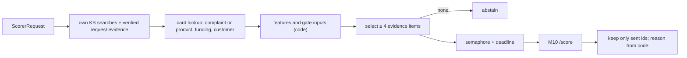

# Z5 — M9 Validation agents (four scorers)

| Field | Value |
|-------|-------|
| Phase | `Z5` from `docs/implementation-plan-zain.md` |
| Owner | Zain |
| Author | Claude Code headless session (`scripts/run-phase.sh`) |
| Branch | `feat/z5-validators` (parent: `feat/z4-scorer-serving`, PR #11) |
| Status | In review |
| Requirement IDs | M9-1..4, VE-2, VE-3, WF-V3, WF-V4, VE-4 (gate inputs), AVOID-4, AVOID-7 |
| Architecture refs | `architecture.md` §6.2, §7.2, §9, §11, §12.2, §12.4, §13.1, §21.4; ADR-001, ADR-005; D-006, D-009 |
| Depends on | Z3 (rubrics, prompts, trace), Z4 (`/score`). M6, M7, M5 not built: `FakeKB`, `FakeAnalyst`, cassettes |
| Issue / PR | #12 / #13 |

---

## Part A — Specification

### A1. Objective
Turn one idea and one student profile into the six dimension scores and the inputs of M11's gates. Four scorers each retrieve their own evidence, compute their features in code, ask M10 once per dimension and return only scores that cite retrieved knowledge-base evidence; otherwise they abstain.

### A2. Context
- Caller: M3 (Z7), `POST /score/{scorer}`. Callees: M6 `/search`, `/cards/{id}`, `/evidence`; M7 `/niches`, `/gaps`; M10 `/score`; `common.llm` alias `agent-cheap` (effort estimate only); M13 `/trace`.
- Exists: `ScorerRequest/Response`, `PartialGateInputs`, KB and analyst contracts, rubrics `r1`, the scorer service, 61 fictional cards. `services/validators` is a stub.
- Still fake: M6, M7, M5. No Gemini key. Z4 measured ≈ 35 s per score on this CPU, six at once exceed the 90 s caller timeout, and the base model once named a competitor that was in no evidence.

### A3. Scope
**In scope:** `services/validators`; `common.fakes` (`FakeKB`, `FakeAnalyst`); `prompts/effort@v1.md`; `VALIDATOR_TIMEOUT` in `common.http`; validators Dockerfile, compose fragment, manifest; fixtures and behaviour tests.

**Out of scope:** calling the four scorers and merging gate inputs, caching, step memo (Z7); claim checking and injection scanning (Z6); the real KB, analyst and tool layer (A2, A4, A6); judging or changing the model's score values (Z9, Z10); `/similar` ideation checks (Z8).

### A4. Requirements and acceptance criteria
Tests are in `services/validators/tests/unit/` unless a path is given.

| # | Req ID | Acceptance criterion | Verified by |
|---|--------|----------------------|-------------|
| 1 | M9-1, M9-2, WF-V3, VE-2 | For 5 fixture ideas each endpoint returns a valid `ScorerResponse`: demand 1 dimension, competition 2, feasibility 2, risk 1 (six, each with its rubric version and its own feature schema) | `test_api.py::test_five_ideas_give_six_dimensions` |
| 2a | M9-4, VE-2 | Every non-abstained score cites ≥ 1 id, and every cited id is among the evidence retrieved from the KB and sent to M10; other ids from M10 are removed, none left → abstain | `test_scoring.py::test_scores_cite_only_retrieved_ids`, `::test_ids_not_sent_are_removed` |
| 2b | M9-4, AVOID-4 | Given an empty source, every scorer abstains with a reason and M10 is not called | `eval/behaviour/test_validators.py::test_empty_source_abstains` |
| 2c | AVOID-4 | Given a model reason naming a competitor that is in no evidence, the response does not contain the name; every product name in the response is the name of a KB card | `eval/behaviour/test_validators.py::test_invented_competitor_name_never_leaves_m9` |
| 3 | M9-3, WF-V4 | Every feature function matches hand-computed values, including `available_hours = hours_per_week × weeks × team_size`; the effort estimate is clamped to the code's band | `test_features.py` |
| 4a | VE-4a | `n_sources` (distinct relevant complaint cards) and `n_platforms` are exact on fixtures | `test_gate_inputs.py::test_evidence_counts` |
| 4b | VE-4d, AVOID-7 | A `duplicate` appears only for the known clone fixture and names that KB card | `test_gate_inputs.py::test_duplicate_only_for_the_clone` |
| 4c | VE-4c | The medical-advice fixture yields a named safety blocker citing KB evidence | `test_gate_inputs.py::test_medical_advice_blocker` |
| 4d | VE-4b, D-006 | `est_effort_hours` and `available_hours` are always sent, also when the model is unavailable and when retrieval is empty | `test_gate_inputs.py::test_effort_is_always_estimated` |
| 5 | M9-3 | Changing only the profile changes only the feasibility scorer's output (same replies for the others) | `eval/behaviour/test_validators.py::test_profile_changes_only_feasibility_and_learning` |
| 6a | M9-1 | With a scorer able to take 6 calls at once, four concurrent scorers finish in < 2 × the slowest single scorer | `eval/behaviour/test_validators.py::test_four_scorers_in_parallel` |
| 6b | AVOID-1 | `VALIDATORS_SCORER_CONCURRENCY` limits M10 calls in flight (default 1); a request past its deadline abstains; deadlines fit the caller's timeout | `test_scoring.py::test_concurrency_limit`, `::test_deadline_abstains`; `test_settings.py` |
| 7 | API-I3, AO-1 | The real M10 app, in process with a cassette, accepts M9's requests; every tool and model call is traced under the run id | `eval/behaviour/test_validators.py::test_real_scorer_contract_and_traces` |

### A5. Interfaces and contracts
- `POST /score/{demand|competition|feasibility|risk}`: `ScorerRequest` → `ScorerResponse` (200). 404 unknown scorer; 422 bad body; 503 `NOT_READY` (rubrics, prompt or URLs missing); 503 `KB_UNAVAILABLE` when retrieval fails (an outage is not "no evidence"). A failed or slow M10 is not an error: the dimension abstains with a reason starting `scoring failed` and `model="none"`.
- No shared contract changes. Additive: `common.http.VALIDATOR_TIMEOUT` (600 s, for M3), `common.fakes`.
- `DimensionScore.reason` is written by code from the features and KB card names; the model's free text is not passed on.
- **`SearchResult.score` is read as a similarity in 0..1** (proposal to Ahmad, A9).
- Traces (agent `validators`): `tool_call` for `search_kb`, `get_cards`, `kb_evidence`, `niches`, `gaps`, `score_dimension`; `llm_call` for the effort estimate (written by `common.llm`, prompt `effort@v1`).
- Env: shared `KB_URL`, `ANALYST_URL`, `SCORER_URL`, `TOOLS_URL`, `LLM_BACKEND`; prefix `VALIDATORS_`: `SCORER_CONCURRENCY` (1), `SCORER_TIMEOUT_S` (90), `DEADLINE_S` (570), `KB_TIMEOUT_S` (10), `EFFORT_TIMEOUT_S` (20), `SEARCH_K` (20), `MAX_EVIDENCE` (4), `MAX_QUOTE_CHARS` (300), `MAX_IDEA_CHARS` (1200), `MIN_SIMILARITY` (0.2), `COMPETITOR_SIMILARITY` (0.75), `DUPLICATE_SIMILARITY` (0.9), `RUBRICS_DIR`, `PROMPTS_DIR`.

### A6. Design
`services/validators/src/validators/`:
- `services/tools.py` — `KnowledgeBase` and `Analyst` protocols and their HTTP clients.
- `services/features.py` — pure functions and keyword tables.
- `services/effort.py` — model estimate, clamped to the band; band midpoint without a model.
- `services/engine.py` — what the scorers share: traced retrieval, evidence selection and bounds, the M10 call under the concurrency limit and deadline, grounding, reasons.
- `scorers/{demand,competition,feasibility,risk}.py` — queries, feature model, gate inputs.

**Retrieval.** Query = idea title + text (≤ 2000 characters). Results below `MIN_SIMILARITY` are dropped. One result per card (the best). A card is a *complaint* if its `niche_tags` contain `complaint`, otherwise a *product*. Request evidence is looked up in M6 (`/evidence`); unknown ids are dropped and M6's text is used.

| Scorer | Evidence pool | Features | Gate inputs |
|--------|---------------|----------|-------------|
| demand | complaints, picked round-robin over platforms | `n_sources`, `n_platforms` (over the whole pool), `complaint_count`, `trend_growth` (slope of the niche most of the pool is tagged with), `recency_days` (age of the newest) | `n_sources`, `n_platforms` |
| competition | products; differentiation also gets the matched niche's gap evidence | `n_competitors` (similarity ≥ 0.75), `funded_competitors`, `max_similarity`, `gap_coverage` (share of the niche's gaps no retrieved product's text covers at least half of; null without gaps) | `duplicate`: top product with similarity ≥ 0.9 whose customer words all appear in the idea |
| feasibility | similar builds (products) | `available_hours`, `est_effort_hours`, `effort_band`, `effort_source`, `hours_ratio`, `required_skills`, `skill_overlap` (Jaccard), `new_skills`, `compute_fit`, `interest_match` (share of interests named in the idea or the builds' tags) | `est_effort_hours`, `available_hours` |
| risk | second search with the words of the matched risk categories; items matching a category first | `risk_hits`, `platform_dependency`, `regulated_domain`, `unconfirmed_blockers` | `blockers` |

**Blockers.** Code rules (medical advice → safety; scraping a platform whose terms forbid it, piracy, personalised investment advice → legal). A blocker is emitted only if a retrieved card mentions the same topic; it cites that card. A matched rule without such evidence makes the risk dimension **abstain** (M11 then cannot say GO because of the risk floor).

**Grounding (AVOID-4).** M10's ids are intersected with the ids sent; dimension and rubric version must match what was asked. The reason is composed by code: score, model id, the main features, competitor names taken from KB cards, cited ids.

**Calls to M10.** One semaphore per process (`SCORER_CONCURRENCY`). Waiting happens before the HTTP call, so the 90 s call timeout covers only scoring. No retry (a retry after a timeout would queue a second job behind the abandoned one; M10 has its own retry and fallback). Request deadline 570 s ≥ 6 × 90 s; M3 waits `VALIDATOR_TIMEOUT` 600 s.

**Prompt size.** ≤ 4 items of ≤ 300 characters, idea ≤ 1200 characters, only the features the rubric lists.

### A7. Edge cases and failure handling
| Case | Expected behaviour |
|------|--------------------|
| Search returns nothing relevant | abstain `no evidence`, no M10 call; gate inputs still sent (0 sources, effort estimate) |
| KB down, timeout, bad reply | 503 `KB_UNAVAILABLE` |
| Card lookup 404 | that result is dropped |
| Analyst down | `trend_growth` / `gap_coverage` null; scoring continues |
| M10 down, timeout, HTTP error, invalid reply | abstain `scoring failed: …`, `model=none`; the other dimension is unaffected |
| M10 returns another dimension or rubric | abstain `scoring failed` |
| M10 cites ids that were not sent | removed; none left → abstain |
| Effort model unavailable, invalid, slow | band midpoint, `effort_source=band_midpoint` |
| Effort model says 1 or 100000 hours | clamped to the band |
| `hours_per_week = 0` | `available_hours = 0`, `hours_ratio` null |
| Score outside 0..1 from the KB | treated as no similarity information: the result is kept for evidence only if ≥ minimum; never a competitor or duplicate |
| Deadline passed while waiting for M10 | abstain `scoring failed: validator deadline` |

### A8. Test plan
| Level | What | Command |
|-------|------|---------|
| Unit | features, effort, tools (mock transport), engine, scorers, API, settings, fakes | `pytest services/validators libs -q --cov=validators --cov=common.fakes` |
| Behaviour | empty source, invented name, profile change, parallel, real M10 with cassette | `pytest eval/behaviour/test_validators.py` |
| Packaging | Dockerfile, compose, manifest, prompts ConfigMap, registry | `pytest eval/behaviour/test_packaging.py`; `python scripts/check_registry.py` |
| Image / manifests | build the validators image, run it, kubeconform | see C3 |
| Cluster | not run (disk; no criterion needs it) | — |

Coverage target: ≥ 80 % of `validators` business logic. No test calls a real model.

### A9. Assumptions and open questions
- `SearchResult.score` is a similarity in 0..1. The contract does not say; M6 (A4) should return one, or add a field. The thresholds are env knobs and must be re-tuned on the real KB.
- M6 tags complaint cards with `complaint` in `niche_tags`, as the fixtures do.
- "Same core features" = similarity ≥ 0.9; "same customer" = all words of the card's customer appear in the idea.
- "Independent source" = a distinct card (card ids come from canonical URLs); "platform" = `EvidenceItem.source`.
- `gap_coverage` counts gaps unaddressed by the retrieved products.
- `FakeKB` similarity is word overlap with the card's name, summary and customer: good enough for fixtures, no measure of real retrieval.
- Retrieved text is not scanned for injections here (M12, Z6); M10 escapes it and cannot decide a verdict.

### A10. Risks
| Risk | Mitigation |
|------|-----------|
| Six CPU scores take 3.5 min or more | calls are serialised, evidence is small, timeouts are consistent; Z11 re-measures |
| Keyword rules miss or over-match (e.g. "not medical advice") | a rule alone never decides: it needs evidence, else the dimension abstains; tuned in Z10 |
| Real KB scores differ from the assumed scale | out-of-range scores never create competitors or duplicates; knobs; follow-up for A4 |
| Disk (4.4 GB free) | build only the validators image, remove it afterwards; no minikube, no model runs |

---

## Part B — Plan

### B1. Task breakdown

| # | Task | Files | Verification | Done |
|---|------|-------|--------------|------|
| 1 | `FakeKB`, `FakeAnalyst`, `VALIDATOR_TIMEOUT` | `libs/common/src/common/{fakes/,http.py}`, tests | `pytest libs` | [x] |
| 2 | Effort prompt in the registry | `prompts/effort@v1.md`, `prompts/kustomization.yaml`, `config/registry.lock.json` | `check_registry.py`, registry tests | [x] |
| 3 | Pure features and keyword rules | `validators/services/features.py` | `test_features.py` | [x] |
| 4 | Settings, tool clients, effort estimate, shared engine | `validators/{settings.py,services/{tools,effort,engine}.py}` | `test_tools.py`, `test_scoring.py` | [x] |
| 5 | Four scorers, routes, app | `validators/{scorers/,api/routes.py,main.py}` | `test_api.py`, `test_gate_inputs.py` | [x] |
| 6 | Fixtures and behaviour tests | `eval/fixtures/validator_*.jsonl`, `eval/behaviour/{test_validators.py,cassettes/validators_*.jsonl}` | `pytest eval/behaviour` | [x] |
| 7 | Image, compose, manifest, env names | `services/validators/{Dockerfile,requirements.txt,compose.yaml}`, `k8s/base/validators.yaml`, `.env.example` | docker build + container check; kubeconform | [x] |
| 8 | Testing subagent, fixes, docs, PR | — | full suite green | [x] |

### B2. Commit plan
1. `docs(spec): add Z5 spec` · 2. `docs(plan): add Z5 plan`
3. `feat(common): add FakeKB, FakeAnalyst and the validator timeout`
4. `feat(prompts): add the effort estimate prompt`
5. `feat(validators): four scorers with computed features, grounding and gate inputs`
6. `test(validators): behaviour tests for abstention, grounding, profile and parallel use`
7. `feat(validators): image, compose and manifest`
8. `test…` / `fix…` (testing subagent) · 9. `docs(Z5): update spec report, checklist, plan, logs`

### B3. Definition of Done (phase)
- [x] All A4 criteria pass, or are left unticked with the reason.
- [x] ruff + mypy clean; coverage target met.
- [x] Dockerfile builds, non-root; manifest validates (kubeconform).
- [x] Checklist rows, plan progress log, deviations, AI log, decisions updated.
- [x] PR opened against `feat/z4-scorer-serving`; reviewer = Ahmad.

---

## Part C — Implementation and test report

### C1. What was built
- `services/validators/src/validators/`: `scorers/{demand,competition,feasibility,risk}.py`; `services/{features,tools,effort,engine}.py`; `settings.py`, `main.py`, `api/routes.py` (replaces the stub).
- `services/validators/{Dockerfile,compose.yaml,requirements.txt}` (adds PyYAML 6.0.4); `k8s/base/validators.yaml` (rubrics and prompts mounted, one scorer slot); dev overlay points at image `467609f`.
- `common.fakes` (`FakeKB`, `FakeAnalyst`), `common.http.VALIDATOR_TIMEOUT`, `prompts/effort@v1.md` (registry lock and prompts ConfigMap updated). No contract or JSON Schema changed.
- Fixes in shared code: `common.trace` hides tool inputs on stdout; `common.http` handles a too deeply nested reply.
- Tests and fixtures: `services/validators/tests/unit/`, `eval/behaviour/test_validators{,_verdict}.py`, `eval/fixtures/validator_{ideas,cards}.jsonl`, `eval/behaviour/cassettes/validators_effort.jsonl` (written by hand).

### C2. Deviations from spec / architecture
| What | Why | Logged in deviations.md as |
|------|-----|---------------------------|
| M9 requests may take 600 s and are not retried; M10 calls are serialised by default | one CPU model | D-010 |
| `tool_call` inputs are hidden on stdout too (not in the first A5) | idea text reached the logs | D-011 |
| Shared scorer prompt; code-written reason; blocker needs evidence, else risk abstains | API-I3, AVOID-4, M9-4 | D-012 |

A4 #6a holds with 6 scorer slots (the test uses a stand-in with a fixed delay). **With the default of 1 slot it does not hold**: the six scores run one after another, by design for the CPU model.

### C3. Test report

**Testing subagent** (`agent-skills:test-engineer`, one run, test files only; it added `test_edge_cases.py` and `eval/behaviour/test_validators_verdict.py`). Its run: ruff and mypy clean (93 files); `pytest -q` 1055 passed, 7 failed (its own bug tests), 8 deselected; coverage of validators and fakes 98 %; `check_registry.py` and compose config ok; kubeconform 27/27; image built (212 MB) and run with `--read-only --network none` (uid 10001, `/ready` 200, 503 `KB_UNAVAILABLE`). It found every A4 criterion covered, no flaky test in five repeats, and that the four responses for all five ideas merge into a valid `VerdictRequest`: a blocker gives NO-GO, an unconfirmed blocker never GO, the clone and the hours gates fail as intended, an empty KB or failed model gives INSUFFICIENT_EVIDENCE.

Bugs found, all fixed (`467609f` has fixes and tests):
1. Idea text reached stdout through the `search_kb` trace input → `common.trace` redacts tool inputs.
2. Blocker rules missed "dosages" and "scraped" (also "bypasses the paywall", "torrenting", named but not tested by it) → shared patterns; tests added for all four.
3. A deeply nested JSON reply from M10 or the KB gave HTTP 500 → `common.http` treats it as an invalid reply.

**Final run:**
| Command | Result |
|---------|--------|
| `ruff check .`, `ruff format --check .`, `mypy libs services scripts` | clean |
| `python scripts/check_registry.py` | ok, 17 entries |
| `pytest -q` | 1065 passed, 8 deselected |
| `pytest services/validators eval/behaviour libs/common/tests/test_fakes.py --cov=validators --cov=common.fakes` | 321 passed, 98 % |
| `kubectl kustomize k8s/overlays/dev \| kubeconform -strict` | 27 valid, 0 invalid |
| `docker compose config -q` | ok (no service started) |
| `docker build` validators at `467609f` | ok, 212 MB |

**Container smoke** (final image, `--read-only`, uid 10001, `--network host`, repo rubrics and prompts mounted) against a host process serving `FakeKB`, `FakeAnalyst` and a stand-in `/score`, M5 absent: `/ready` 200; eight requests 200 for the clone and medical ideas; the clone gave the `SlideCards` duplicate, the medical idea the safety blocker; effort fell back to the band midpoint (100 h of 240 h); the clone idea's text was not in the container logs. With the host process stopped: 503 `KB_UNAVAILABLE`.

**Not run / not verified:** minikube; `pytest -m integration` (no database code changed); **any real model** (scores, latency and the effort estimate), the real M6, M7 and M5. The fixtures say nothing about retrieval or scoring quality.

Disk: 4.4 GB free before and after, lowest observed 4.3 GB. The images built here were removed and the build cache pruned.

### C4. Measurements
| Measure | Value |
|---------|-------|
| Image size | 212 MB on disk (same base layers as the other services) |
| Model input per score (bound, not measured on a model) | ≤ 4 quotes × 300 characters, idea ≤ 1200 characters (before XML escaping) |
| Expected scoring time on this CPU (estimate from Z4's 35 s per score) | 6 scores ≈ 3.5 min, one after another |

### C5. Follow-ups
- **Z7:** call M9 with `VALIDATOR_TIMEOUT` and `retry=False`; merge the partial gate inputs; on 503 `KB_UNAVAILABLE` fail the step, and never cache a verdict with a `scoring failed` score; consider not caching one whose `effort_source` is `band_midpoint`; record `effort@v1` and `scorer@v1` in `prompt_versions`; give the deployment `TOOLS_URL`/M5 for effort estimates.
- **Z6:** scan retrieved evidence (`/scan`) before it reaches M10 and the validators; M9 does not.
- **Z8:** competitor names in ideation need the same KB-only rule.
- **Z10:** tune the keyword tables (blockers cannot read negation; word forms are limited), effort bands and thresholds on the labelled set.
- **Z11:** build the other service images again to pick up the two `common` fixes; measure real latency; raise `VALIDATORS_SCORER_CONCURRENCY` only with more M10 slots.
- **Ahmad (A4):** return `SearchResult.score` as a similarity in 0..1 (or add such a field), tag complaint cards with `complaint` in `niche_tags`, keep `GET /cards/{id}` and `POST /evidence`. Until this is confirmed the duplicate gate and competitor counts are not reliable on a real KB. (A6): `Niche.niche_id` or `name` should match card `niche_tags`.
- Smaller (Z5-15): minimum similarity is not applied to request evidence; only the top product is checked as a duplicate; threshold order is not validated; a deadline can free the slot while M10 is still working; gap statements without Latin letters count as unaddressed.
- Base-model scores can contradict the features (Z4 C4); M9 passes M10's score through unchanged.
