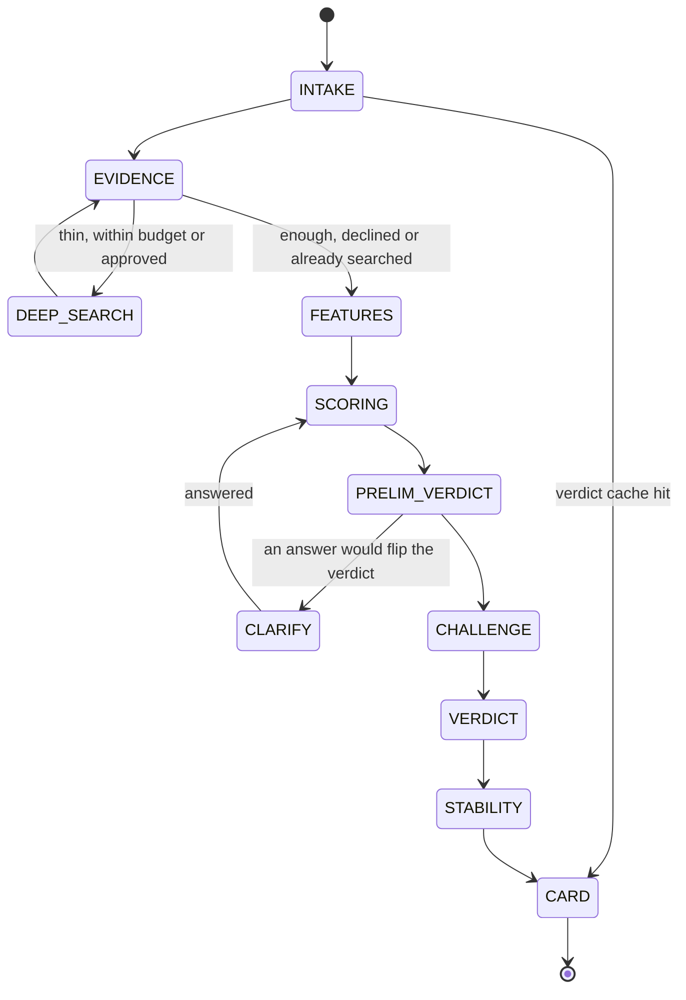

# Z7 — M3 Orchestrator: run lifecycle + Validate workflow

| Field | Value |
|-------|-------|
| Phase | `Z7` from `docs/implementation-plan-zain.md` |
| Owner | Zain |
| Author | Claude Code headless session |
| Branch | `feat/z7-orchestrator-validate` (parent `feat/z6-critic-guardrails`, PR #15 unmerged) |
| Status | Testing |
| Requirement IDs | `M3-1..6, WF-V1..V9, U3, U4, U5, U6, U10, AO-1, AO-2, M2-4, M2-5, AVOID-1, AVOID-2, AVOID-3` |
| Architecture refs | `architecture.md §6.1–6.3, §6.5, §6.7, §7.2, §8.4, §8.5, §15, §21.3–21.4`, ADR-001, ADR-004 |
| Depends on | Z2 (M11), Z5 (M9), Z6 (M12), all real. Fakes: M2, M4, M5, M6, gateway; M8 is the Z1 stub |
| Issue / PR | filled in Part C |

---

## Part A — Specification

### A1. Objective
Replace the Z1 stub run with the real Validate workflow: an explicit, checkpointed state machine that calls the other modules, runs the four scorers in parallel, stays inside a per-run budget (asking before it goes over), asks only questions that can change the result, re-runs only what changed, and ends in a verdict card whose verdict comes from M11 and nowhere else, with every step traced.

### A2. Context
- M3 is called by the gateway (M1, not built). It calls M2 (store), M6 (KB), M4 (scouts), M8 (ideation), M9 (validators), M11 (verdict), M12 (critic), M13 (traces, spend) and Redis (events, step memo).
- Real: M9, M11, M12, M13, `libs/common`. Not built: M1, M2, M4, M5, M6 (Ahmad). M8 is a stub until Z8 (no questions, no objections).
- Everything not built is reached over HTTP through the shared contracts. Tests answer those calls with in-memory fakes; the image contains no fake.

### A3. Scope
**In scope:** `RunState` and Validate step transition tables; run, answer, approve, resume, startup recovery; all Validate steps; budgets and approval; clarify; step memo; verdict cache; run events; trace records and D-007 events; `GET /runs/{id}`; bounded shutdown and meaningful `/ready`; manifests, compose and image of the orchestrator.

**Out of scope:** Discover, `POST /ideas/{id}/challenge` and `/whatif` (Z8: both answer 501 now); real M8 agents (Z8); replay command (Z10); real M2/M4/M6 (A1, A3, A4); a user cancel endpoint and a sweeper for expired waiting runs; cluster run and measurements (Z11).

### A4. Requirements and acceptance criteria
Test files are under `services/orchestrator/tests/unit/` unless a path is given.

| # | Req ID | Acceptance criterion | Verified by |
|---|--------|----------------------|-------------|
| 1 | M3-1, WF-V1 | Every transition of §6.1 and §6.2 (plus the cache shortcut INTAKE→CARD) is allowed; every other pair is rejected; a request that does not fit the run's state (answer, approve, resume) is HTTP 409 | `test_state_machine.py`, `test_api.py::test_wrong_state_is_409` |
| 2 | WF-V1..V9, U6, M3-6 | Given the fakes, a Validate run ends COMPLETED; the stored card validates as `Verdict` with gates, six scores citing evidence ids, weights, confidence, stability; step decisions in the trace equal the path taken | `test_validate.py::test_happy_path`, `eval/behaviour/test_orchestrator.py` (real M9, M11, M12) |
| 3 | M3-2, WF-V3 | The four scorer calls are in flight at the same time | `test_validate.py::test_scorers_run_in_parallel` |
| 4 | M3-4, U4, M12-4, AO-2 | Thin evidence and an estimate over the remaining budget → `AWAITING_APPROVAL` with an `approval_required` event stating cost and pages, and no scout call. Approve → budget raised, one scout call, pages spent, search again. Decline → no scout call, run completes (INSUFFICIENT EVIDENCE with `missing` when evidence stays short, U10). Both decisions are recorded in M2 and as `approval` events. Deep search happens at most once | `test_budget.py` |
| 5 | AO-2, AVOID-1 | A spending step with the steps, token or cost cap used up → `BUDGET_STOPPED`, no further agent call, no card | `test_budget.py::test_hard_cap_stops_run` |
| 6 | U5, WF-V1 | A candidate question whose two answers give the same M11 verdict is not asked; one that flips it is asked (`AWAITING_INPUT`, `question` event). After the answer (which passes the input rail) a new idea version (origin `clarify`) exists, only scorers for affected dimensions are called again, and the others are logged as `cache_hit`. One clarify round at most | `test_clarify.py` |
| 7 | M3-5 | A second run of the same idea with a changed profile calls only the feasibility scorer | `test_cache.py::test_profile_change_rescores_feasibility_only` |
| 8 | M2-4, M2-5, AVOID-2 | An identical re-run is a verdict-cache hit (no scorer call, `from_cache`, `cache_hit` event and trace record); a new rubric set or profile version misses | `test_cache.py` |
| 9 | M2-4, D-009 | A card built with a failed or `model=none` score, a fallback model, or any degraded step is not put in the verdict cache | `test_cache.py::test_degraded_runs_are_not_cached` |
| 10 | M3-3, D-010, AVOID-1 | A scorer call has a 600 s limit and is never retried after a timeout; invalid replies, 429 and 5xx are retried at most twice inside the same 600 s; then that scorer's dimensions abstain and the run completes. `KB_UNAVAILABLE` fails the run | `test_scoring.py`, `eval/behaviour/test_orchestrator.py` (cassette) |
| 11 | M3-1 | A new orchestrator process on the same M2 and Redis, while a run is `AWAITING_APPROVAL`, accepts the approval and completes it; a run interrupted while RUNNING is picked up at startup from its last checkpoint, without a second deep search | `test_resume.py` |
| 12 | U3 | The run's Redis stream holds `RunEvent`s with consecutive `seq`, naming the running agent, its tool calls and the spend, in order, also across a pause | `test_validate.py::test_event_stream` |
| 13 | VE-1, WF-V9, AVOID-3 | The stored and published verdict equals M11's reply; M3 only adds concretizer text to `what_would_make_go[].change` and, on a cache hit, sets `from_cache` and the run/idea ids. Model replies that carry a verdict are rejected by the contracts | `test_verdict_guard.py` |
| 14 | WF-V6, M12-1 | Objections are checked by `/check`; only `supported` ones citing sent evidence reach M11; an unavailable check applies none, removes no claim and marks the run degraded | `test_validate.py::test_challenge_*` |
| 15 | AO-1, DATA-6 | Every step, downstream call and decision has a trace record under the run id; M3 sends `run_started`, `run_status`, `approval`, `verdict`; M3 records carry no tokens or cost (the model caller records them once); spend is read from M13 | `test_validate.py::test_trace_records` |
| 16 | Z2 follow-up | The checkpoint and the M11 call's trace keep the original (pre-penalty) scores and accepted objections | `test_validate.py::test_original_scores_kept` |
| 17 | Z1 follow-up | The verdict call is bounded to 15 s in total; shutdown cancels run tasks and bounds the trace flush so the whole stop fits in 30 s with a hanging M13 | `test_lifecycle.py` |
| 18 | Z1 follow-up, K8S-5 | `/ready` is 503 without Redis, with a missing or malformed required URL, invalid rule files, or when a dependency listed in `ORCH_READY_REQUIRES` is not ready | `test_lifecycle.py::test_ready_*` |

### A5. Interfaces and contracts
**M3 API** (`contracts/orchestrator.py`, `core.RunStatus`):

| Endpoint | Success | Errors |
|----------|---------|--------|
| `POST /runs` | 202 `StartRunResponse` | 404 idea version unknown or another user's; 422; 501 `NOT_IMPLEMENTED` for discover; 503 M2 or Redis down |
| `GET /runs/{id}` (new) | 200 `RunStatus` | 404, 503 |
| `POST /runs/{id}/answer` | 202 | 404; 409 not awaiting input or expired; 422 ids do not match the pending questions, or the rail refuses an answer |
| `POST /runs/{id}/approve` | 202 | 404; 409 not awaiting approval, other `approval_id`, or expired |
| `POST /runs/{id}/resume` | 202 | 404; 409 terminal or waiting for the student |
| `POST /ideas/{id}/challenge`, `/whatif` | — | 501 until Z8 |

Every `/runs/{id}` endpoint needs the `X-User-Id` header the gateway sets from the token (§21.2): missing → 422, another user's run → 404. On `POST /runs` a header that differs from `user_id` is 403.

No shared contract changes. The checkpoint is private to M3 and travels in `RunUpdate.state`.

**Calls M3 makes to services that do not exist** (paths proposed to Ahmad; bodies are existing contracts):

| Call | Body → reply |
|------|--------------|
| `GET /internal/ideas/versions/{version_id}` (M2) | → `Idea` with that version in `versions` |
| `POST /internal/ideas/{idea_id}/versions` (M2) | `IdeaVersionCreate` → `IdeaVersion` |
| `POST/PATCH/GET /internal/runs…` (M2) | `RunCreate` / `RunUpdate` → `RunRecord` |
| `POST /internal/approvals`, `PATCH /internal/approvals/{id}` (M2) | `ApprovalCreate` / `ApprovalUpdate` → `Approval` |
| `POST /internal/verdicts` (M2) | `VerdictStore` → `VerdictStored` |
| `GET/PUT /internal/cache/verdicts/{key}` (M2) | → `CachedVerdict`; PUT body `Verdict` |
| `POST /search`, `POST /evidence`, `GET /stats` (M6) | `contracts/kb.py` |
| `POST /scout` (M4) | `ScoutRequest` → `ScoutResponse` |

**Events:** Redis stream `run:{id}:events`, one `RunEvent` per entry (unchanged). **Traces:** `tool_call` per downstream call (`input` = request body, `output` = ids and labels only, because outputs reach stdout); `decision` records `step`, `cache`, `evidence`, `clarify`, `challenge`, `approval_policy`, and the D-007 events; the verdict-cache lookup is a `tool_call` with `tool="verdict_cache"`.

**Config** (prefix `ORCH_`): `BUDGETS_PATH`, `RUBRICS_DIR`, `PROMPTS_DIR`, `READY_REQUIRES` (default `profile,verdict`), `DEEP_SEARCH_PAGES` (15), `DEEP_SEARCH_PAGE_COST_USD` (0.0005), `SCOUT_SOURCES` (`hackernews,github`), `SEARCH_K` (20), `WAIT_TIMEOUT_S` (86400), `SCORER_TIMEOUT_S` (600). Shared: `VERDICT_URL`, `PROFILE_URL`, `VALIDATORS_URL`, `KB_URL`, `SCOUTS_URL`, `CRITIC_URL`, `IDEATION_URL`, `AGENTOPS_URL`, `SCORER_MODEL_ID` (`scorer-base@v1`), `REDIS_*`.

### A6. Design
`services/orchestrator/src/orchestrator/`:

| File | Responsibility |
|------|----------------|
| `services/state_machine.py` | `Step` enum, both transition tables, `InvalidTransition`, the `Checkpoint` model |
| `services/runner.py` | create, answer, approve, resume, recover; the drive loop; one task per run; shutdown |
| `services/validate.py` | one function per step |
| `services/run.py` | what a step needs for one run: events, decisions, spend, traced calls |
| `services/downstream.py` | HTTP clients of the agents, M6, M4, M11, M13 with their timeouts |
| `services/budget.py` | pure budget arithmetic and the deep-search estimate |
| `services/rules.py` | rubric versions, prompt versions, budgets (`common.registry`) |
| `repositories/profile.py` | M2 client |
| `repositories/events.py`, `repositories/memo.py` | Redis stream; step memo and the active-run set |

Validate steps (`QUEUED → RUNNING`, then):

Approval is asked in EVIDENCE (before DEEP_SEARCH); CLARIFY waits for the answer.

- **Checkpoint:** after every step and transition: run status, step, budget, spend, pending question or approval, and the outputs of completed steps (idea, evidence, scorer replies, M11 request). Stored in M2 (`RunUpdate.state`).
- **Thin evidence:** fewer distinct cards than `gates.evidence.min_sources` or fewer sources than `min_platforms` of M11's active config (`GET /config`).
- **Clarify filter:** for each candidate, apply each answer's `score_deltas` (clamped to 0..5, scored dimensions only) through M11 `/whatif` `apply`; an answer without applicable deltas keeps the preliminary label. Ask when the two labels differ. After the answers, scorers whose dimensions are in an asked question's `affects` get the new idea text; the others keep their old input, so their memo key hits.
- **Step memo:** `cache:step:{step}:{digest}` in Redis, 24 h, only when the KB version is known. Evidence search: query, k, KB version. Scorer: name, idea, evidence, rubric and prompt versions, scorer model, KB version, and the profile for `feasibility` only. Failed scorer replies and midpoint effort estimates are not stored.
- **Verdict cache:** key `common.cache_keys.verdict_key` with all nine parts (idea text = title and text; engine and weights from M11 `/config`; KB version from M6 `/stats`). No KB version → no cache. Stored only if the run had no degraded step and no clarify round, and every scored dimension has `model == SCORER_MODEL_ID`.
- **Budget:** M3 counts steps (one per agent or tool call; M11 and M2 calls are free) and pages; tokens and cost are the sums of the run's records in M13. Before a spending step: any cap used up → `BUDGET_STOPPED`.

### A7. Edge cases and failure handling
| Case | Expected behaviour |
|------|--------------------|
| M12 rail refuses the idea | `FAILED`, error code `INPUT_REJECTED` with the rail's reasons; no model call |
| M12 rail unreachable | `FAILED` (a guard fails closed) |
| M12 `/scan` unreachable | the same rules from `common.injection` are applied locally |
| Flagged evidence | never sent to the scorers or the Skeptic |
| M12 `/policy/approval` unreachable | approval is required |
| M12 `/check` unreachable or `unverifiable` | objection not applied; nothing removed; run degraded |
| M8 intake, skeptic or concretize fails | continue without; run degraded |
| M6 `/search` or `/evidence` fails | `FAILED` (`KB_UNAVAILABLE`); `/stats` fails → no cache |
| A cited id M6 does not know | stripped; a score with none left abstains |
| M4 fails | continue with the evidence there is; degraded; the search is not repeated |
| M9 fails (see A4 #10) | that scorer abstains; its gate inputs stay empty |
| M11 fails | `FAILED` after 3 attempts within 15 s |
| M13 unreachable | spend keeps its last value; the run continues |
| Redis fails mid-run | events and memo are skipped, the run continues |
| M2 fails mid-run | the drive stops without a state change; the run stays resumable (error event) |
| Double approve or answer | the second is 409 |
| Waiting longer than `WAIT_TIMEOUT_S` | `CANCELLED` on the next answer, approve or resume |

### A8. Test plan
| Level | What | Command |
|-------|------|---------|
| Unit | transitions, budget, workflow with a fake stack over `httpx.MockTransport`, real M11 app | `pytest services/orchestrator -q` |
| Contract | every fake validates requests against `common.contracts`; replies are validated by M3 | same |
| Behaviour (cassettes) | real M9, M11, M12 and M13 apps in process; recorded M8, scorer and judge replies | `pytest eval/behaviour -q` |
| Integration | the orchestrator on a real Redis: stream, memo, active set | `pytest -m integration services/orchestrator` |
| Image | build, run against fake services over HTTP, one full run | manual, recorded in C3 |

Coverage target: ≥ 90 % of `services/orchestrator/src`.

### A9. Assumptions and open questions
- M2's missing read of one idea version and its cache `PUT` body are as in A5 (Ahmad may change them; only `repositories/profile.py` depends on them).
- One orchestrator replica: per-run tasks and locks are in process.
- Startup recovery uses a Redis set of active run ids, so M2 needs no list endpoint. If Redis loses it, `POST /runs/{id}/resume` still works.
- The profile in `StartRunRequest` is the one `profile_version` refers to; M3 does not re-read it from M2.
- M13 lags by up to its flush interval (2 s), so token and cost spend is slightly late; M5 enforces its own caps (A2).
- Clarify uses only what M11 can compute: an abstained dimension cannot be moved, so a question that only affects it is not asked.
- Scorer claims are not sent to `/check` in Validate: WF-V6 checks the Skeptic's objections; checking a scorer claim is the challenge feature (Z8).

### A10. Risks
| Risk | Mitigation |
|------|-----------|
| M2's real API differs from the proposal | all M2 calls are in one file with one protocol |
| Clarify answers appended to a long idea are cut off by M9's 1200-character bound | recorded as a follow-up for M9 tuning (Z10) |
| A run takes minutes on the CPU model | scorer limit 600 s, memo, resume |

---

## Part B — Plan

### B1. Task breakdown
| # | Task | Files | Verification | Done |
|---|------|-------|--------------|------|
| 1 | Transition tables, checkpoint, budget arithmetic, rules loader | `services/{state_machine,budget,rules}.py`, `settings.py`, tests | `pytest services/orchestrator/tests/unit/test_state_machine.py` | [x] |
| 2 | M2 client, event stream sequence, memo, downstream clients | `repositories/*`, `services/downstream.py` | mypy | [x] |
| 3 | Run context, Validate steps, runner | `services/{run,validate,runner}.py` | happy path test | [x] |
| 4 | Routes, app wiring, readiness, shutdown; remove the Z1 stub | `api/routes.py`, `main.py` | API and lifecycle tests | [x] |
| 5 | Fake stack and workflow tests (budget, clarify, cache, scoring, resume, guard) | `tests/unit/*`, `tests/integration/*` | `pytest services/orchestrator` | [x] |
| 6 | Behaviour tests with real M9, M11, M12, M13 and cassettes | `eval/behaviour/test_orchestrator.py`, cassettes | `pytest eval/behaviour` | [x] |
| 7 | Image, compose, manifest, `.env.example` | `Dockerfile`, `compose.yaml`, `requirements.txt`, `k8s/base/orchestrator.yaml` | build, container run against fakes, kubeconform | [x] |
| 8 | Testing subagent, fixes | tests | full suite | [ ] |
| 9 | Docs and PR | `docs/**`, README | — | [ ] |

### B2. Commit plan
1. `docs(spec)`, 2. `docs(plan)`, 3. `feat(orchestrator): state machine, budget and rules`, 4. `feat(orchestrator): validate workflow and run API`, 5. `test(orchestrator): …`, 6. `build(orchestrator): …`, 7. `fix(orchestrator): …` (from the test report), 8. `docs(Z7): …`.

### B3. Definition of Done (phase)
- [ ] All A4 criteria pass.
- [ ] ruff, ruff format and mypy clean; coverage target met.
- [ ] Orchestrator image builds and runs non-root; manifests validate; image removed afterwards.
- [ ] Checklist, plan, decisions, deviations, AI log updated.
- [ ] PR opened against `feat/z6-critic-guardrails`; never merged.
