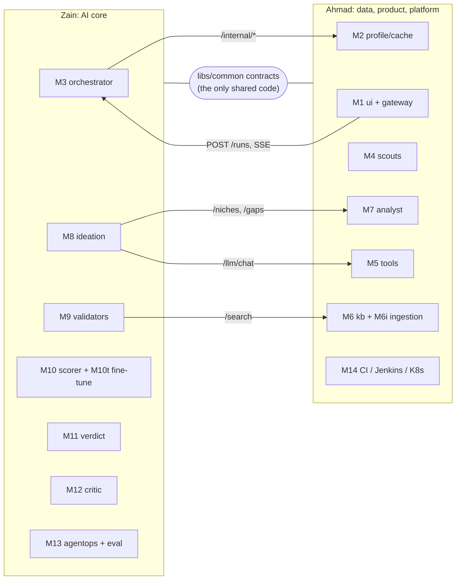
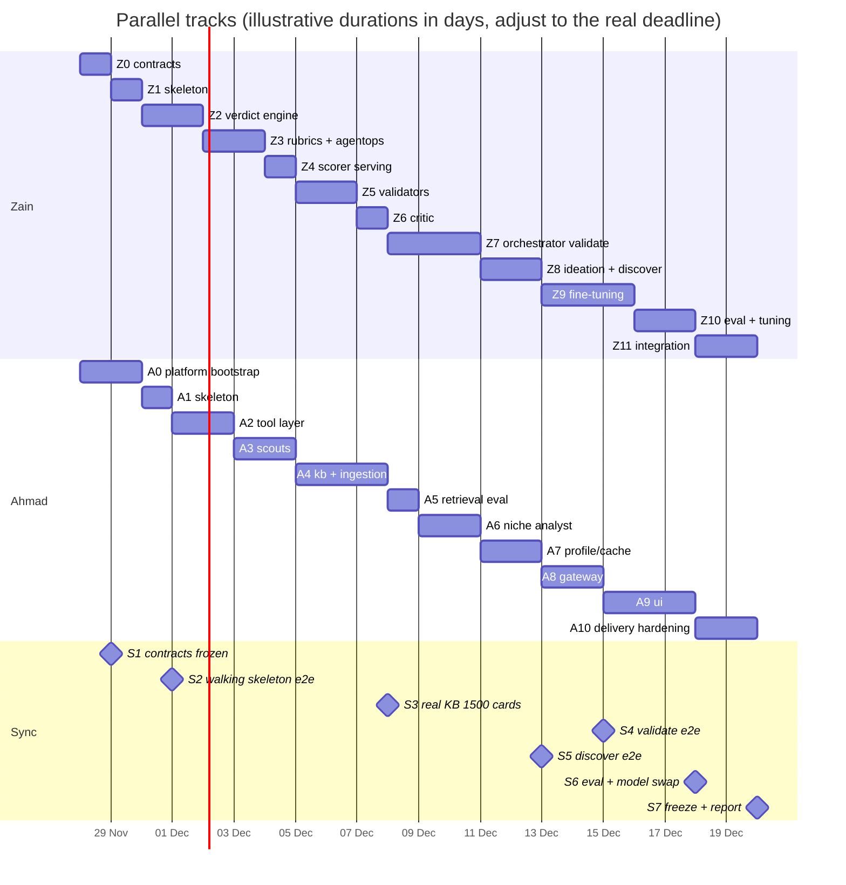

# Work Distribution — Zain & Ahmad

> Goal: two **parallel** tracks with the **fewest hand-offs**. Each person owns whole modules end to end (code, tests, Dockerfile, compose fragment, k8s manifest, spec, docs rows). Cross-track dependencies are removed by **contracts first + fakes**: you code against the JSON contracts in `libs/common` and a fake of the other side, never against the other person's unfinished code.
>
> Related: [`requirements.md`](requirements.md) (IDs), [`architecture/architecture.md`](architecture/architecture.md), [`workflow.md`](workflow.md), [`implementation-plan-zain.md`](implementation-plan-zain.md), `implementation-plan-ahmad.md` (Ahmad creates it from §4 below, same format).

---

## 1. Ownership at a glance

| Track | Owner | Theme | Modules |
|-------|-------|-------|---------|
| **Z** | **Zain** | AI core: decide, score, reason, observe | M3 Orchestrator, M8 Idea Generator, M9 Validators, M10 Scoring Model, M10t Fine-tuning, M11 Verdict Engine, M12 Critic & Guardrails, M13 AgenticOps |
| **A** | **Ahmad** | Data, product surface and platform | M1 UI + API Gateway, M2 Profile/Session/Cache, M4 Scouts, M5 Tool Layer, M6 Knowledge Base, M6i Ingestion, M7 Niche & Trend Analyst, M14 Platform (CI, Jenkins, K8s) |

### 1.1 Cross-track interfaces (the only places we touch each other)
| Interface | Provider → Consumer | Contract file | Until the real one exists, the consumer uses |
|-----------|---------------------|---------------|-----------------------------------------------|
| `POST /search`, `/evidence` (M6) | Ahmad → Zain (M9, M8, M12) | `contracts/kb.py` | `FakeKB` over `eval/fixtures/cards_small.jsonl` (≈ 60 hand-made cards) |
| `/niches/match`, `/gaps` (M7) | Ahmad → Zain (M8, M9) | `contracts/analyst.py` | `FakeAnalyst` fixture JSON |
| `/llm/chat` (M5) | Ahmad → Zain (M8, M10, M12, M10t) | `contracts/tools.py` | `common.llm` with `LLM_BACKEND=direct` (LiteLLM → Gemini/Ollama) |
| `/scout` (M4) | Ahmad → Zain (M3 deep search) | `contracts/scouts.py` | `FakeScouts` returns 0–3 fixture cards |
| `/internal/*` (M2) | Ahmad → Zain (M3) | `contracts/profile.py` | `FakeStore` (in-memory) |
| `POST /runs`, `/answer`, `/approve`, `/challenge`, `/whatif`, run events (M3) | Zain → Ahmad (M1) | `contracts/orchestrator.py` | `FakeOrchestrator` + recorded SSE event fixture `eval/fixtures/run_events_validate.jsonl` |
| Verdict / DimensionScore / TraceRecord shapes | Zain → everyone | `contracts/core.py` | — (delivered first, Z0) |
| `/summary` (M13) | Zain → Ahmad (UI Ops page) | `contracts/ops.py` | fixture `eval/fixtures/ops_summary.json` |

**Rule:** a contract change is a PR that touches the contract file **and** is reviewed by the other person before merge. Additive changes (new optional fields) are cheap; breaking changes need a version bump (`…V2`) and a line in `deviations.md`.

---

## 2. Shared-file ownership (avoids merge pain)

| Path | Owner | Others may… |
|------|-------|-------------|
| `libs/common/src/common/contracts/core.py`, `orchestrator.py`, `agents.py`, `verdict.py`, `ops.py` | Zain | propose via PR |
| `libs/common/src/common/contracts/kb.py`, `analyst.py`, `tools.py`, `scouts.py`, `profile.py`, `gateway.py` | Ahmad | propose via PR |
| `libs/common/src/common/{service,trace,llm,http,cache_keys}.py` | Zain | propose via PR |
| `services/<svc>/**` (incl. Dockerfile, `compose.yaml`) | module owner | never edit without asking |
| `k8s/base/<svc>.yaml` | module owner | — |
| `k8s/base/kustomization.yaml`, `k8s/base/netpol-*.yaml`, `k8s/base/ingress.yaml`, `k8s/overlays/**` | Ahmad | add own resource line to `kustomization.yaml` (tiny, expected conflicts) |
| `docker-compose.yml` (root, includes fragments) | Ahmad | add own `include:` line |
| `.github/workflows/**`, `Jenkinsfile`, `scripts/{smoke_test,netpol_test,push_images,create_secrets}.sh` | Ahmad | propose via PR |
| `scripts/run-phase.sh` | Zain | — |
| `config/verdict.yaml`, `config/budgets.yaml` | Zain | — |
| `config/sources.yaml`, `config/llm-models.yaml` | Ahmad | Zain requests alias changes via PR |
| `rubrics/**`, `prompts/**` | Zain | — |
| `eval/retrieval/**`, `data/snapshots/**` | Ahmad | — |
| `eval/labelled/**`, `eval/behaviour/**`, `eval/fixtures/**` | Zain | Ahmad adds UI/gateway fixtures under `eval/fixtures/ui/` |
| `eval/results/**` | whoever produced the result | — |
| `jobs/ingestion/**` | Ahmad | — |
| `jobs/finetune/**`, `jobs/evaluation/**` | Zain | — |
| `docs/requirements.md`, `docs/architecture/architecture.md` | shared | change via PR reviewed by the other + `deviations.md` entry |
| `docs/checklist.md` | shared | each ticks **only own rows** |
| `docs/architecture/deviations.md`, `docs/ai-usage-log.md` | shared, **append-only** | add rows at the bottom |
| `docs/specs/Z*.md` / `docs/specs/A*.md` | Zain / Ahmad | review in PR |
| `docs/implementation-plan-zain.md` / `docs/implementation-plan-ahmad.md` | Zain / Ahmad | — |
| `docs/report/**` | section owner (see §6) | — |

---

## 3. Zain's track (Z) — summary

Full detail (objective, description, acceptance criteria, progress log) in [`implementation-plan-zain.md`](implementation-plan-zain.md).

| Phase | Title | Needs from Ahmad | Unblocks for Ahmad |
|-------|-------|------------------|--------------------|
| Z0 | Shared contracts + `libs/common` + repo tooling | — | contracts for every module (S1) |
| Z1 | Walking skeleton of Zain's 7 services (stubs, Dockerfiles, compose, k8s manifests) | A0 namespace/kustomize base (or creates own manifests and Ahmad wires them) | UI/gateway can call stub orchestrator (S2) |
| Z2 | M11 Verdict Engine (complete) | — | real verdict JSON for UI card |
| Z3 | Rubrics + prompts registry + M13 AgenticOps core (traces, summary, budgets) | — | `/summary` for Ops page; trace client for Ahmad's services |
| Z4 | M10 Scorer serving (base model, schema validation, retry, hosted fallback) | (fake M5 → direct mode) | — |
| Z5 | M9 Validators (4 scorers, features, abstain, gate inputs) | M6 fake → real at S3 | — |
| Z6 | M12 Critic & Guardrails | M6 fake | — |
| Z7 | M3 Orchestrator: run lifecycle + Validate workflow | M2 fake → real | Validate end-to-end (S4) |
| Z8 | M8 Ideation + M3 Discover + challenge / what-if | M7 fake → real | Discover end-to-end (S5) |
| Z9 | M10t fine-tuning pipeline + base/fine-tuned/hosted comparison | real KB (S3) for dataset | fine-tuned model image |
| Z10 | Evaluation harness, behaviour tests, replay, drift, labelled set, verdict tuning | real cluster (S4) | nightly eval Job for Jenkins |
| Z11 | Cluster integration of Zain's services, measured requests/limits, end-to-end acceptance, evidence | all | — |
| Z12 | Report + submission (shared) | — | — |

## 4. Ahmad's track (A) — summary

Ahmad turns these into `docs/implementation-plan-ahmad.md` (same format as Zain's plan: objective, description, acceptance criteria, progress log per phase) and writes a spec per phase in `docs/specs/A<n>-<slug>.md` (see [`workflow.md`](workflow.md) §7).

| Phase | Title | Key requirements | Needs from Zain | Unblocks for Zain |
|-------|-------|------------------|-----------------|-------------------|
| A0 | Platform bootstrap: minikube + Calico profile, namespace, Kustomize base, default-deny NetworkPolicies skeleton, root `docker-compose.yml` (Postgres-pgvector + Redis), GitHub Actions `pr-checks` (lint/type/test/build matrix/Trivy/kubeconform), required checks on `main`, Jenkins container + Jenkinsfile skeleton, GHCR push script | GIT-1, CI-1..6, JEN-3/4, LOC-1/2, K8S-7 (skeleton) | nothing | cluster + CI for everyone (S2) |
| A1 | Walking skeleton of Ahmad's 7 services (ui, gateway, profile, scouts, tools, kb, analyst): `/health`, `/ready`, stub endpoints, Dockerfiles, manifests | GEN-8, DOCK-1..3, K8S-1/5 | Z0 contracts | S2 |
| A2 | M5 Tool Layer: `/fetch` (allow-list, robots, rate limit, cache, sanitiser, budgets) + `/llm/chat` (LiteLLM, aliases, limiter, cache, cost) + `tools-internet-egress` NetworkPolicy + `netpol_test.sh` | M5-1..8, ETH-1/2/5, AO-2, K8S-7/10 | — | Zain switches to `LLM_BACKEND=gateway` |
| A3 | M4 Scouts: HN, GitHub, YC connectors (+ optional PH/Reddit), per-source limits + failure handling, CronJobs, on-demand `/scout` | M4-1..4, ETH-1..4 | — | deep search for M3 |
| A4 | M6 KB + M6i ingestion: `kb` schema + Alembic, dedupe/chunk/embed/index, idempotent upserts, ≥ 1,500 cards from ≥ 3 sources, snapshot + seed Job, `/search` hybrid + rerank + filters, `/evidence`, `/stats` | M6-1..5/7, M6i-1..4, ETH-6, DATA-1/3 | — | **S3 real evidence** (Z5, Z6, Z9) |
| A5 | Retrieval evaluation: ≥ 20 hand-written queries, recall@k / MRR for 4 retrieval variants, baseline, CI gate; ADR-002 numbers | M6-6, EVAL-5, CI-4 | — | — |
| A6 | M7 Niche & Trend Analyst: clustering, naming, monthly series, rising/flat/saturated, gaps with evidence, `/niches/match`, recompute CronJob | M7-1..4 | — | real niches/gaps for Z8 |
| A7 | M2 Profile/Session/Cache: `app` DB + Alembic, layered routes/services/repositories, users/profiles/ideas/versions/runs/verdicts/approvals/conversations, verdict cache API, compare | M2-1..6, DATA-2/9, U1, U9 | contracts `profile.py` (Ahmad) | real store for M3 (S4) |
| A8 | M1 Gateway: register/login (argon2 + JWT), rate limits, validation, proxy to M2/M3, SSE from Redis Streams, `/metrics`, `/ops/summary`, HPA | M1-2..5/7/8, API-P1..8, K8S-6 | `FakeOrchestrator` until Z7 | S4 |
| A9 | M1 UI (React + Vite + TS): login, profile, Discover, Validate chat + clarify, live agent feed + spend, approval prompt, verdict card (gates, six scores + evidence links, weights, confidence, stability, BORDERLINE flips), challenge, what-if → v2, history + compare, INSUFFICIENT EVIDENCE view, Ops dashboard; runtime `config.js`; component tests | U1–U10 (UI side), M1-1/2/6, CI-3 | SSE fixture until Z7 | screenshots SS-8..15 |
| A10 | M14 delivery hardening: full Jenkinsfile (build+tag SHA, push, deploy, smoke, nightly eval), rollout + rollback demo, HPA demo, NetworkPolicy test evidence, requests/limits from `kubectl top`, green + failing runs, Trivy clean | M14-1..5, JEN-1..4, K8S-1..12, DOCK-4 | Z10 eval Job | SS-1..7 |
| A11 | Report + submission (shared) | SUB-* | — | — |

## 5. Timeline and sync points

Both tracks run in parallel from day 1. Sync points are short integration sessions (both present, ~1–2 h), not hand-offs.

| Sync | When | Exit criteria |
|------|------|---------------|
| **S1** Contracts v1 | after Z0 | `libs/common` merged; Ahmad reviewed `core.py`; both can `pip install -e libs/common` |
| **S2** Walking skeleton | after Z1 + A0 + A1 | all 14 services `Running` on minikube; Ingress → UI → gateway → orchestrator stub → verdict stub returns a contract-valid card; CI green on `main` (AVOID-8) |
| **S3** Real knowledge base | after A4 | ≥ 1,500 cards from ≥ 3 sources searchable; snapshot committed; Zain swaps `FakeKB` → real M6 |
| **S4** Validate end-to-end | after Z7 + A7 + A8 (+ UI basics) | U1, U3, U4, U5, U6, U10 work on the cluster with real services |
| **S5** Discover end-to-end | after Z8 + A6 | U2, U7, U8, U9 work |
| **S6** Evaluation + model swap | after Z9 + Z10 | fine-tuned scorer live; confusion matrices before/after; nightly eval green in Jenkins |
| **S7** Freeze | before submission | all checklist rows ticked or explained; screenshots; report; signed contribution table |

## 6. Shared tasks (both)

| Task | Requirement | How |
|------|-------------|-----|
| Review every PR of the other person (within 24 h) | GEN-1, GIT-1 | GitHub review; at least one substantive comment or approval |
| Deliberate merge conflict | GIT-4 | During A10/Z11: both branch from the same commit and edit the same lines of `config/budgets.yaml` comment header; Ahmad merges first, Zain resolves in his PR; screenshot SS-2 |
| Labelled set for tuning | EVAL-1 | Zain drafts ~40 ideas + profiles (clear GO / clear NO-GO / borderline / thin evidence); **both label independently** in `eval/labelled/labels_<name>.csv`; resolve differences together; final file notes who labelled what |
| Hand-check fine-tuning labels | FT-3 | Zain checks ≥ 40, Ahmad checks ≥ 20 (marked `checked_by`) |
| AI-usage log | GEN-2, SUB-4 | each appends own rows to `docs/ai-usage-log.md` per PR |
| Report | SUB-2 | sections by owner: (a) summary & changes — Zain; (b) modules & architecture figure — both; (c) verdict design — Zain; (d) knowledge base — Ahmad; (e) fine-tuning — Zain; (f) AgenticOps — Zain; (g) platform — Ahmad; (h) limits & next steps — both. Outline in `docs/report/report-outline.md` |
| Screenshots | SUB-3 | Ahmad: SS-1..9, SS-17; Zain: SS-10..16, SS-18 (list in `docs/evidence/screenshots/captions.md`) |
| Contribution table | SUB-5 | `docs/contribution.md`, filled from `git shortlog`/PR list, signed by both |
| Be able to explain the whole system | GEN-1 | each presents the other's modules to the other once before submission |

## 7. Working agreements
1. **Never wait.** If you need something from the other track that is not ready, use the fake listed in §1.1 and keep going. Record the swap-to-real task in your plan.
2. **Contracts are king.** Code against `libs/common` contracts; validate in and out; no private side channels.
3. **Small PRs, one purpose**, one issue per task (GIT-2), conventional commits (GIT-3).
4. **Spec before code** for every phase (`docs/specs/`), see [`workflow.md`](workflow.md).
5. **Docs stay true:** tick your checklist rows, log deviations, append to the AI-usage log in the same PR as the code.
6. **Protected `main`:** nobody pushes to `main`; the other person approves your PR.
