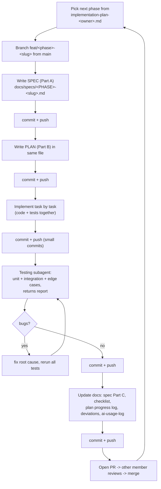

# Workflow — Spec-Driven Development with Headless Claude Sessions

> How every phase gets built, by both Zain and Ahmad. The goal is a **traceable** history: every phase has a spec + plan in `docs/specs/`, every requirement is ticked in `docs/checklist.md`, every deviation is logged, and nothing drifts from the baseline (`requirements.md` + `architecture/architecture.md`).

## Contents
1. [The loop at a glance](#1-the-loop-at-a-glance)
2. [Document map and maintenance rules](#2-document-map-and-maintenance-rules)
3. [Git model (protected main)](#3-git-model-protected-main)
4. [Phase lifecycle (the steps)](#4-phase-lifecycle-the-steps)
5. [Running a phase in a headless Claude session (Zain)](#5-running-a-phase-in-a-headless-claude-session-zain)
6. [PR template](#6-pr-template)
7. [Ahmad's workflow (same process, any tool)](#7-ahmads-workflow-same-process-any-tool)
8. [Deviation handling](#8-deviation-handling)
9. [Definition of Done](#9-definition-of-done)
10. [Sync points and integration](#10-sync-points-and-integration)
11. [Troubleshooting](#11-troubleshooting)

---

## 1. The loop at a glance



For Zain, everything from **Branch** to **Open PR** runs inside **one headless Claude Code session** started by `scripts/run-phase.sh <PHASE>` (§5). The session ends after the PR is opened; Zain reviews the result, Ahmad approves the PR, Zain merges, then the next phase starts from the updated `main`.

---

## 2. Document map and maintenance rules

| File | Purpose | Updated when | By |
|------|---------|--------------|----|
| `docs/requirements.md` | Single source of truth for **what** (IDs) | Only if a PDF requirement was misread → PR + deviation | both (reviewed) |
| `docs/architecture/architecture.md` | Designed **how** (diagrams, contracts, decisions) | Only together with a `deviations.md` entry | both (reviewed) |
| `docs/architecture/deviations.md` | Log of every change from the designed architecture | Whenever implementation differs from architecture/spec | whoever deviates (append-only) |
| `docs/checklist.md` | Progress per requirement ID | End of every phase (own rows only) | owner |
| `docs/work-distribution.md` | Who owns what, interfaces, sync points | Ownership change (rare) | both agree |
| `docs/implementation-plan-zain.md` / `-ahmad.md` | Phases with objective, description, acceptance criteria, progress log | Start of phase, each push, end of phase | owner |
| `docs/specs/<PHASE>-<slug>.md` | Spec (A) + plan (B) + implementation & test report (C) for one phase | During the phase | owner |
| `docs/specs/template.md` | Template for specs | Rarely | both |
| `docs/conventions.md` | Code, test, commit conventions | When a convention changes | both |
| `docs/decisions/ADR-*.md` | Design decision records (≥ 3 required) | When a significant decision is made/changed | decision owner |
| `docs/decisions.md` | Running log of every implementation decision (append-only) | Whenever a phase takes a decision | author |
| `docs/ai-usage-log.md` | What AI wrote, what we changed, why (GEN-2) | Every PR that used AI | author (append-only) |
| `docs/setup.md` | How to set up the project on a new machine | When tooling/setup changes | whoever changes setup |
| `docs/contribution.md` | Signed contribution table | End of project | both |
| `docs/report/` | Final report (+ outline) | Z12/A11 | section owners |
| `docs/evidence/` | Screenshots (with captions), measurements, eval outputs for the report | When evidence is produced | producer |
| `README.md` | How to run everything (for markers / new people) | When run commands change | both |
| `CLAUDE.md` (git-ignored, Zain only) | Context + rules for Claude sessions | When rules/context change | Zain |

**Anti-drift rule:** if code and docs disagree, either fix the code or update the doc **and** log a deviation in the same PR. Never leave them out of sync across a merge.

---

## 3. Git model (protected main)

- `main` is protected (GIT-1): no direct pushes, PR required, 1 approving review from the other member, required status checks (added once CI exists in A0), conversation resolution required.
- Branch names: `feat/<phase-id>-<slug>` (e.g. `feat/z2-verdict-engine`), `fix/<scope>-<slug>`, `docs/<slug>`, `chore/<slug>`.
- One issue per task (GIT-2): create an issue for the phase (`gh issue create --title "Z2: Verdict engine" --body "Spec: docs/specs/Z2-verdict-engine.md"`) and link it in the PR (`Closes #n`).
- Conventional commits (GIT-3): `feat(verdict): add duplicate gate`, `fix(kb): dedupe by url`, `test(scouts): add source failure case`, `docs(spec): add Z2 spec`, `chore(ci): …`.
- **Stacked work:** if phase N+1 needs phase N's unmerged code, branch N+1 from N's branch and open the PR against N's branch (`--base feat/z2-…`); retarget to `main` after N merges.
- Never force-push a shared branch; never rewrite pushed history; never merge your own PR without review (admins can technically bypass — don't).

---

## 4. Phase lifecycle (the steps)

1. **Pick** the next `Not started` phase whose dependencies are met (plan's dependency graph). Set status `In progress`, add a progress-log row.
2. **Branch** from fresh `main` (`git checkout main && git pull && git checkout -b feat/<phase>-<slug>`).
3. **Spec (Part A)**: copy `docs/specs/template.md` → `docs/specs/<PHASE>-<slug>.md`. Fill objective, scope, requirement IDs, acceptance criteria (each mapped to a test), interfaces, design, edge cases, test plan, assumptions. → `git commit -m "docs(spec): add <PHASE> spec" && git push -u origin HEAD`.
4. **Plan (Part B)**: ordered small tasks with files and verification, commit plan, DoD. → `git commit -m "docs(plan): add <PHASE> plan" && git push`.
5. **Implement** task by task; tests with the code; run `ruff check`, `mypy`, `pytest` frequently. Small conventional commits; push after each meaningful group.
6. **Test** with a **separate testing subagent** (fresh context, test-only changes, returns a report — see the prompt in §5.3). Fix every reported bug at its root cause; rerun everything until green. → commit + push.
7. **Docs**: spec Part C (what was built, deviations, test report, measurements, follow-ups); tick `docs/checklist.md` rows; update the plan (status `In review`, progress log with timestamps, tick acceptance criteria); `docs/architecture/deviations.md`; `docs/ai-usage-log.md`; README/setup/architecture if affected. → `git commit -m "docs(<phase>): update tracking docs" && git push`.
8. **PR**: `gh pr create` with the template (§6); request the other member's review. **Do not merge yourself without approval.**
9. **After merge** (human): set the plan status to `Done` with the completion time and PR link (small `docs:` commit in the next phase's branch is fine).

---

## 5. Running a phase in a headless Claude session (Zain)

### 5.1 Command

```bash
# from the repo root, on a clean working tree
scripts/run-phase.sh Z2                              # run phase Z2
scripts/run-phase.sh Z5 "KB is still fake; use FakeKB"   # optional extra instructions
PERMISSION_MODE=bypassPermissions scripts/run-phase.sh Z2   # if 'auto' mode blocks needed commands
```

What the script does (`scripts/run-phase.sh`):
1. Extracts the prompt between the `HEADLESS-PROMPT` markers below and replaces `{{PHASE}}`.
2. Runs `claude -p "<prompt>" --model ${MODEL:-claude-sonnet-5-5} --effort ${EFFORT:-medium} --strict-mcp-config --permission-mode ${PERMISSION_MODE:-auto} -n phase-<PHASE> --output-format stream-json --verbose`.
3. Streams the full session log to `.claude-runs/<PHASE>-<timestamp>.jsonl` (git-ignored) and prints the final message.

Watch it live from another terminal: `tail -f .claude-runs/<file>.jsonl | jq -r 'select(.type=="assistant") | .message.content[]? | select(.type=="text") | .text'`.

After it ends: read the final message, open the PR (`gh pr view --web`), skim the spec and test report, then ask Ahmad to review. Next phase only after merge (or stack, §3).

**Permission mode.** `auto` lets Claude Code's safety classifier approve routine commands (git on feature branches, pytest, docker build, kubectl get/apply in the project namespace) and deny risky ones; in headless mode a denied action is skipped, not prompted. If a phase repeatedly fails because a needed command is denied, rerun with `PERMISSION_MODE=bypassPermissions` — only on this repo, with a clean tree, and review the diff afterwards.

### 5.2 The headless prompt

The script sends exactly this text (with `{{PHASE}}` replaced). Edit it here, not in the script.

<!-- HEADLESS-PROMPT:START -->
```text
You are an unattended (headless) Claude Code session implementing phase {{PHASE}} of the "Idea Generator with Go / No-Go" project (course CS4032). Nobody will answer questions during this session. When something is ambiguous, choose the option most consistent with docs/requirements.md and docs/architecture/architecture.md, write the assumption into the spec (section A9), log it in docs/decisions.md, and continue.

DECISION LOG (mandatory): every choice you make that requirements.md and architecture.md do not already fix (libraries and versions, schema or field choices, defaults, assumptions, shortcuts, skipped or deferred work, test strategy, blocker workarounds) gets one row appended to docs/decisions.md (ID <PHASE>-<n>, with why, rejected alternatives, affected files/IDs). Add rows as you decide and commit them with the related change.

READ FIRST (only what is relevant to {{PHASE}}):
1. CLAUDE.md — project context and rules.
2. docs/workflow.md — this process. Follow section 4 exactly.
3. The {{PHASE}} section of the owner's plan: docs/implementation-plan-zain.md for Z phases, docs/implementation-plan-ahmad.md for A phases (objective, description, deliverables, acceptance criteria).
4. docs/requirements.md — every requirement ID listed for {{PHASE}}.
5. docs/architecture/architecture.md — the sections the phase references; docs/decisions/ for related ADRs.
6. docs/decisions.md (decisions earlier phases already took; stay consistent with them); docs/conventions.md; docs/work-distribution.md section 2 (file ownership: edit only files this phase owns); docs/specs/template.md; docs/architecture/deviations.md.
7. Existing code you will call or extend (libs/common contracts, earlier services, fakes).

STEPS:
1. Git setup: git fetch origin; git checkout main; git pull. If {{PHASE}} depends on code that exists only in an unmerged PR branch, branch from that branch and target the PR at it. If EXTRA INSTRUCTIONS name a parent branch, check out and pull that branch instead of main, and target the PR at it. Create branch feat/<phase id in lowercase>-<short slug>. In the plan, set {{PHASE}} status to "In progress" and add a progress-log row (timestamp from: date '+%Y-%m-%d %H:%M').
2. SPEC: copy docs/specs/template.md to docs/specs/{{PHASE}}-<slug>.md and fill Part A completely (every acceptance criterion mapped to a requirement ID and a named test). Commit "docs(spec): add {{PHASE}} spec" and run: git push -u origin HEAD.
3. PLAN: fill Part B in the same file (small ordered tasks with files and verification, commit plan, DoD). Commit "docs(plan): add {{PHASE}} plan" and push.
4. IMPLEMENT Part B task by task, writing tests together with the code. Use the repo virtualenv (source .venv/bin/activate). Run ruff check, mypy and pytest as you go. Make small conventional commits and push after each meaningful group.
5. TEST: spawn exactly ONE testing subagent with the Agent tool (subagent_type "agent-skills:test-engineer"; if unavailable use "general-purpose"). Give it the spec path, the acceptance criteria, the changed files, and the commands. Use the testing-subagent prompt in docs/workflow.md section 5.3. Wait for its report.
6. FIX every bug in the report at its root cause (not the symptom). Re-run the full test suite, ruff and mypy until everything is green. Commit the new tests and fixes and push.
7. DOCS: fill spec Part C (what was built, deviations, the subagent's test report with commands and results, measurements, follow-ups). Tick the rows in docs/checklist.md for requirements this phase completed (only rows owned by this phase's owner). Update the plan: status "In review", progress-log rows for spec, plan, implementation, tests and PR with timestamps, tick the acceptance criteria that pass. Append to docs/architecture/deviations.md any difference from the architecture or spec (and update architecture.md accordingly), or nothing if there is none. Append one row to docs/ai-usage-log.md. Check that docs/decisions.md has a row for every decision taken in this phase. Update README.md / docs/setup.md / .env.example if run commands, setup or env vars changed. Commit "docs({{PHASE}}): update spec report, checklist, plan, logs" and push.
8. PR: create an issue for the phase if none exists (gh issue create), then gh pr create --base main (or the parent branch) with title "<type>(<scope>): {{PHASE}} <phase title>" and a body following the PR template in docs/workflow.md section 6, including "Closes #<issue>". Try to request the other member as reviewer (gh pr edit --add-reviewer <login>); ignore failure. NEVER merge the PR.
9. FINISH with a short final message: branch, PR URL, what was delivered, test results (counts, coverage), deviations, open issues and follow-ups.

HARD RULES:
- Never push to main, never force-push, never merge a PR, never rewrite pushed history, never delete branches you did not create.
- Never commit or print secrets (.env, API keys, tokens, kubeconfig). Only .env.example with names.
- Edit only files owned by this phase's owner (docs/work-distribution.md section 2). If another owner's contract or file must change, describe the proposal in the PR body instead of editing it.
- The language model never decides or adjusts a verdict; only the M11 Verdict Engine does. Every score and claim must cite evidence ids, otherwise abstain.
- Everything is validated against the contracts in libs/common. Never hard-code localhost in images; config via env vars / ConfigMaps.
- No destructive commands: no rm -rf outside build artefacts you created, no docker system prune, no minikube delete, no kubectl delete namespace, no database drops outside test containers.
- Disk space is limited (about 10 GB free): build only the images you touched. At the end remove only the images you built (docker rmi by tag) and run "docker builder prune -f". Never run "docker image prune" or remove images or volumes of other projects. If free disk (df -h ~) drops below 2 GB, stop building and record it as a blocker. Stop the idea-validator minikube profile and any compose services you started before you finish.
- Pin every new dependency in the service's requirements.txt (and requirements-dev.txt if needed locally). Install only into .venv.
- Stay in scope. Out-of-scope ideas go to spec Part C "Follow-ups".
- If blocked (missing credential, cluster down, dependency not ready and no fake possible): do everything else, set the phase status to "Blocked" with the reason in the plan, push, open a DRAFT PR (gh pr create --draft), and stop.
```
<!-- HEADLESS-PROMPT:END -->

### 5.3 Testing-subagent prompt (used by the session in step 5)

```text
You are the testing agent for phase <PHASE>. Spec: docs/specs/<PHASE>-<slug>.md (read Part A acceptance criteria and test plan).
Changed files: <list>. Work in the repo virtualenv (.venv).
1. Review the existing tests against every acceptance criterion; write missing unit, contract and integration tests (and behaviour/cassette tests where the spec asks). Put them under the service's tests/ folder (or eval/behaviour for behaviour tests).
2. Try edge cases and failure modes from spec A7 (timeouts, invalid model output, empty evidence, boundary values, bad config).
3. Run: ruff check .; mypy on touched packages; pytest with --cov for touched packages; docker build for touched services; kubeconform for touched manifests (if available).
4. Do NOT modify production code. Do NOT commit. Only add or edit test files and fixtures.
5. Return a concise report: (a) commands run and results (pass/fail counts, coverage %), (b) each failing test or bug with file:line, reproduction and suspected root cause, (c) acceptance criteria not covered by any test, (d) any flaky or slow tests.
```

### 5.4 Session hygiene
- Start each phase from a clean tree (`git status` empty) on `main`.
- One phase per session. If a session dies, rerun the script with an extra instruction like `"Resume: branch feat/z5-validators exists; continue from step 4"`.
- Keep `.claude-runs/` logs until the phase is merged (they help the AI-usage log); they are git-ignored.

---

## 6. PR template

```markdown
## <PHASE>: <title>

**Spec:** docs/specs/<PHASE>-<slug>.md · **Plan:** docs/implementation-plan-<owner>.md#<phase> · Closes #<issue>

### Summary
- What this PR delivers (3–6 bullets).

### Requirements covered
`M11-1`, `VE-4a`, … (ticked in docs/checklist.md)

### Acceptance criteria
- [x] … (copied from the plan, ticked if passing)

### Test evidence
- `pytest services/verdict -q --cov` → 87 passed, coverage 97 %
- `ruff check .` / `mypy …` → clean
- docker build / kubeconform → ok

### Deviations
- None | see docs/architecture/deviations.md D-00X

### AI usage
- Tool + what it produced, what we changed (row added to docs/ai-usage-log.md)

### Reviewer checklist
- [ ] Code matches spec and contracts
- [ ] Tests meaningful (not just coverage)
- [ ] Docs/checklist/plan updated
- [ ] No secrets, no hard-coded localhost
```

---

## 7. Ahmad's workflow (same process, any tool)

Ahmad follows **the same lifecycle (§4)** for every A-phase, whether coding by hand or with an AI tool:

1. Create `docs/implementation-plan-ahmad.md` once, from `work-distribution.md` §4, using the same format as `implementation-plan-zain.md` (phase overview table, then per phase: status, spec, branch, requirements, depends on, objective, description, deliverables, acceptance criteria, progress log). First PR: `docs(plan): add Ahmad's implementation plan`.
2. For each phase `A<n>`: branch `feat/a<n>-<slug>` → copy `docs/specs/template.md` to `docs/specs/A<n>-<slug>.md` → write Part A → commit + push → Part B → commit + push → implement with tests → run a separate test pass (a second AI chat/agent focused only on tests, or by hand) and record it in Part C → fix → update checklist (own rows), plan progress log, deviations, ai-usage-log → PR with the template (§6) → Zain reviews.
3. If Ahmad also uses Claude Code, he can run the same script: `scripts/run-phase.sh A4` (the prompt reads `implementation-plan-ahmad.md` for A phases). He needs his own `CLAUDE.md` (copy the template section from `docs/setup.md` §9) since `CLAUDE.md` is git-ignored.
4. Contract changes in Zain-owned files → propose in the PR body or open a small PR for Zain to review.

This keeps both tracks equally traceable: every phase of either member has a spec, a plan, a test report and checklist ticks in the repo.

---

## 8. Deviation handling

A deviation is any difference between what was built and what `architecture.md` (or a merged spec) says: different technology, endpoint, schema field, flow, threshold default, ownership, or an unmet requirement.

1. Append a row to `docs/architecture/deviations.md` (ID `D-NNN`, date, phase, owner, what, why, impact, requirement IDs affected, follow-up).
2. Update `architecture.md` in the same PR so it describes reality (keep the original in the deviation row).
3. If it changes a requirement interpretation, update `requirements.md` and note it.
4. If it is significant (technology/design choice), add or supersede an ADR.
5. Mention the deviation ID in the PR body. The report's section (a) "changes from the architecture" is compiled from this log.

---

## 9. Definition of Done

A phase is **Done** when:
- [ ] Spec Parts A, B, C complete in `docs/specs/`.
- [ ] Every acceptance criterion has a passing test (or a documented manual check with evidence).
- [ ] Lint + type checks clean; coverage target from the spec met.
- [ ] For services: Docker image builds (multi-stage, non-root, pinned), manifest validates, `/health` and `/ready` work.
- [ ] Checklist rows ticked, plan progress log and status updated, deviations and AI-usage log appended.
- [ ] PR reviewed and approved by the other member, all required checks green, merged to `main`.

---

## 10. Sync points and integration

Sync points S1–S7 are defined in `work-distribution.md` §5. At each one: both members pull `main`, run `docker compose up` (or deploy to minikube), walk the exit criteria together, file issues for gaps, and record the outcome as a progress-log row in both plans. Swap fakes for real services only after the real one is merged.

---

## 11. Troubleshooting

| Symptom | Fix |
|---------|-----|
| Session stops early: "permission denied" for a needed command | Rerun with `PERMISSION_MODE=bypassPermissions` (clean tree, review diff) |
| `git push` rejected on `main` | Expected — work on the feature branch |
| Session produced code but no PR | Rerun with extra instruction `"Resume from step 7"` |
| Tests need Postgres/Redis | `docker compose up -d postgres redis` before running the session |
| Disk full during docker build | `docker image prune -f`, `docker builder prune -f`; see `docs/setup.md` §8 |
| Gemini 429 rate limit | Use cassettes / `LLM_BACKEND=fake` in tests; real calls only in manual checks |
